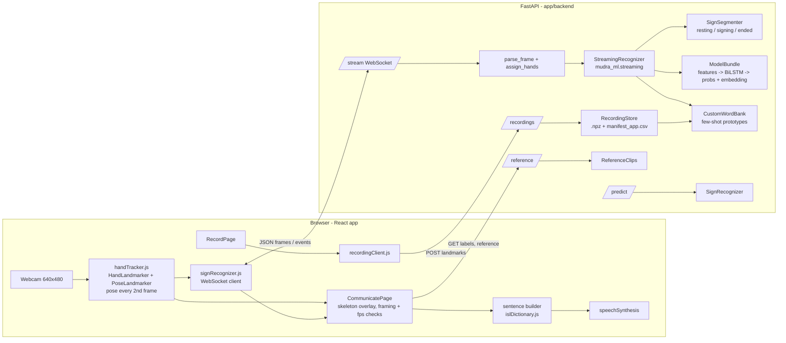

# MUDRA: Handover Document

> **Read this first.** This is the single source of truth for anyone (human or AI model) taking over
> MUDRA. It describes the architecture, interfaces, data, models, results, open problems and the
> history of decisions. It is updated at **every push**: see [Section 0](#0-how-to-use-and-update-this-document).

| Field | Value |
|---|---|
| Document version | 12 |
| Last updated | 2026-10-23 |
| Last updated at commit | the commit after `b5ee2e6`: v15b, tools/, speech model download, GPU in diagnostics (Section 21) |
| Deployed models | words: `app/backend/models/isl_mudra_combined_v15b_bilstm` (339 signs + `_BACKGROUND_`; v13b and older kept for rollback); letters: `isl_letters_v1` (A-Z); phrases: `isl_phrases_v1_bilstm` (99); experimental, opt-in: `mudra_intro_static_pose_medoids_v1` (teammate's static poses, 10 live words) |
| Live settings | `training/configs/streaming.json` (commit threshold 0.7), `training/configs/fewshot.json` |
| Tests | 97 backend passing (`pytest app/backend/tests`, 2026-10-21: API on the deployed model, library, references, speech, SignLine Emergency; data-dependent tests skip without `data/metadata`) + 51 frontend (`npm test` in `app/frontend`: avatar, meeting, tracker, game, practice, emergency) |
| Repository | `https://github.com/Addy-coder786/Mudra` (remote `mudra`); older pushes: `Addy-coder786/ISL_Addy` (remote `origin`) |
| Overall state | Recognition is accurate on new takes by **signers seen in training**; accuracy for new people is unmeasured (about 67% on unseen recording sessions); **live use on a real laptop webcam is not yet reliable** (Section 16). Audit: `docs/AUDIT_2026-10-13.md` |

---

## Table of contents

0. [How to use and update this document](#0-how-to-use-and-update-this-document)
1. [Project summary, goals and constraints](#1-project-summary-goals-and-constraints)
2. [Current state at a glance](#2-current-state-at-a-glance)
3. [Repository map](#3-repository-map)
4. [System architecture](#4-system-architecture)
5. [Live recognition: end-to-end data flow](#5-live-recognition-end-to-end-data-flow)
6. [Interfaces: HTTP API, WebSocket protocol, configuration](#6-interfaces-http-api-websocket-protocol-configuration)
7. [Landmarks and the feature vector](#7-landmarks-and-the-feature-vector)
8. [The recognition model](#8-the-recognition-model)
9. [Sign segmentation and the commit decision](#9-sign-segmentation-and-the-commit-decision)
10. [Recording tool and few-shot custom words](#10-recording-tool-and-few-shot-custom-words)
11. [Training pipeline](#11-training-pipeline)
12. [Data: sources, splits, label fixes, licences](#12-data-sources-splits-label-fixes-licences)
13. [Evaluation methodology and current results](#13-evaluation-methodology-and-current-results)
14. [Model version history](#14-model-version-history)
15. [Experiments tried and not adopted](#15-experiments-tried-and-not-adopted)
16. [Known issues and open problems](#16-known-issues-and-open-problems)
17. [Environment, setup and running](#17-environment-setup-and-running)
18. [Tests](#18-tests)
19. [Rules and conventions](#19-rules-and-conventions)
20. [Glossary](#20-glossary)
21. [Change log (newest first)](#21-change-log-newest-first)

---

## 0. How to use and update this document

### For an AI model or engineer taking over

1. Read Sections 1, 2 and 16 to know what works, what does not and what is next, and the current
   blueprint (`docs/blueprints/`, now v1.1) for the target and the milestone being worked on.
2. Read Sections 4-10 before touching runtime code, and 11-13 before touching training or claims.
   Feature documents: `docs/SIGN_LIBRARY.md` (letters, phrases), `docs/SIGNLINE_EMERGENCY.md` (SOS assistant),
   `docs/SCALING_VOCABULARY.md` (barriers between words, v9, how to grow to 400-500 words).
   The recommended next steps are at the top of Section 16.
3. Never report a metric that is not in this document or produced by a script in this repo
   (Section 19). Numbers here are **held-out test** numbers unless labelled otherwise.
4. File paths are relative to the repository root. Code is the authority: if this document and
   the code disagree, the code wins and this document must be corrected in the same push.

### Update protocol (mandatory at every push)

Before every `git push`, the person or model pushing must:

1. Add an entry at the top of [Section 21](#21-change-log-newest-first) with: date, short commit
   hash(es), what changed, why, and measured effect (with the split it was measured on).
2. Update every other section the change affects. Typical mapping:

   | If you changed | Update sections |
   |---|---|
   | The deployed model or its training recipe | header table, 2, 8, 11, 13, 14 |
   | `training/configs/streaming.json` or `mudra_ml/streaming.py` | 9, 13 |
   | An API endpoint, request/response field or WebSocket event | 6 |
   | The feature layout, normalisation or `schema.py` | 7 (and retrain) |
   | Data, manifests or split sets | 12 |
   | Something tried and rejected | 15 |
   | A bug found or fixed, a new limitation | 16 |
   | Setup, dependencies, ports | 17 |
   | Tests added or removed | 18, header test count |
   | Files added, moved or removed | 3 |

3. Bump "Document version", "Last updated" and "Last updated at commit" in the header table.
4. The repo ships a pre-push hook (`.githooks/pre-push`) that refuses a push whose commits do not
   touch `HANDOVER.md`. Enable it once per clone: `git config core.hooksPath .githooks`.
   Bypass only for trivial pushes (typo fixes) with `SKIP_HANDOVER_CHECK=1 git push`.

---

## 1. Project summary, goals and constraints

**MUDRA** is an Indian Sign Language (ISL) learning and communication web app:

- **Sign → text → speech** (Communicate page): the webcam watches the signer; each isolated sign is
  recognised, appended to a sentence, the sentence is translated (English / Hindi / Marathi) and
  spoken with the browser's speech synthesis.
- **Text / speech → sign** (Communicate, Learn): a 3D avatar (Three.js, `ybot.glb`) performs
  26 letters and 13 words.
- **Learning and practice** (Learn, Practice, Progress): lessons and a rule-based coach for 8 signs,
  with locally stored practice history.
- **Recording** (Record): users record signs (landmarks only) to teach new words and to collect
  training data with signer names.
- **Fingerspelling and phrases** (2026-10-16): letters A-Z and 99 phrases in Learning, Game Mode and
  Communication (*Spell* / *Phrase* modes); see `docs/SIGN_LIBRARY.md`.
- **Emergency help** (2026-10-16): an SOS circle on every page opens a demo emergency-communication
  assistant that contacts no one; see `docs/SIGNLINE_EMERGENCY.md`.

The web app is branded **SignLine** (Section 5.2). Code, packages and the repository keep the name MUDRA
(`mudra_api`, `mudra_ml`); only user-facing text says SignLine.

**Primary goal (current):** reliable real-time recognition in actual use: detect when a sign starts
and ends, never commit a word from one or two frames, recognise the signs the model was trained on,
build a sentence and speak it.

**Hard constraints carried from the original specs** (`docs/planning/`, original implementation specs):

- Only landmark coordinates leave the browser; never camera images or video.
- No emotion claims: the facial module describes facial *cues* ("smiling", "eyebrows raised"), not
  feelings, and is labelled experimental.
- No fabricated metrics anywhere in the app or docs.
- Evaluate with signer- or session-independent splits where possible; never tune on test data.
- No Random-Forest classifier as the recogniser (the original app used one at ~44%).
- Urgency / context features would need an explicit user confirmation UI (not built yet).

**Origin.** The project merges the "MUDRA handoff package" with the team's GitHub repo
(`aryanhinge20-dot/Mudra_ISL_Platform`, site `mudra-isl.vercel.app`). The team's own data lives at
`C:\ISL` on the development machine (Section 12). Previous pushes went to
`https://github.com/Addy-coder786/ISL_Addy` (remote `origin`).

---

## 2. Current state at a glance

| Area | State | Evidence |
|---|---|---|
| Web app, rebranded **SignLine** (Section 5.2) | Working | Google sign-in with automatic local fallback (2026-10-23, `docs/MOBILE_AND_JUDGES.md`) and User / Admin roles; User: Home, Communication, Learning, Game Mode, Progress, Teach a sign, Settings; Admin: Overview, Users, Content, Records, Reports, Game rules, Settings; checked in desktop and mobile screenshots |
| **SignLine Emergency** (SOS circle, bottom-right of every page) | **Prototype, demo mode** | buttons / simulated signs / personal gestures → rule-based report with provenance → user confirms → mock delivery to an in-app responder desk; contacts no one; 29 tests; checked in desktop and mobile screenshots. `docs/SIGNLINE_EMERGENCY.md` |
| **Cloud copies of track points + skeleton video** (`docs/CLOUD_STORAGE.md`) | Working (2026-10-23) | Teach a sign, Communication and the practice camera upload the hand and body landmarks of each frame (never camera video, images, names or emails; a signed-in account only as a one-way hash) to the team's Supabase project through `/cloud/recordings` (secret key on the server only; files rejected); the server then draws a stick-figure WebM from those points into the studio's bucket + `signline_videos`, so the recording plays in the studio; "Cloud save (track points only)" switch on each camera page; off without keys. Checked on the real project, videos played back in Chrome; Learning path by unit tests only |
| **Meetings: Google Meet / Zoom** (`docs/MEETING_INTEGRATION.md`) | **Prototype, not yet tried in a real call** | Chrome extension (`app/meeting-extension`) shows the MUDRA panel in Meet / Zoom Web and sends the tab audio to local speech recognition (sherpa-onnx); the avatar signs stable phrases while people speak (first sign 1.4-1.9 s after the word in tests), signs -> local Windows voice -> VB-Cable as the meeting microphone. Tested: unit tests, a recorded-voice end to end, the extension on a mock meeting page including real tab capture (started by its shortcut with real keystrokes), the voice through VB-Cable 4.5 (installed, Test route verified, words transcribed back from CABLE Output). Not tested: a real call, a second participant. Meet add-on / Zoom App: code only, need registration |
| Accounts and roles | **Demo only** | no server accounts or passwords; role kept in the browser; anyone can open Admin (Section 16) |
| Game Mode | Working (local) | 70 lessons over the 314 words, real recorded examples, quizzes, XP / streak / badges in localStorage; no leaderboard (needs accounts) |
| Recognition model **v15b** | Deployed 2026-10-23 | v13b + all 214 recorded takes (33 signs; new MY, NAME, MY_NAME), takes x6, fine-tuned from v13b: owner's held-out takes 62/66, 0 wrong; other test 1,451 right / 15 wrong; live 12 fps benchmark 27/32, 0 wrong |
| Recognition model **v13b** | Deployed 2026-10-21 (evening), now rollback | v12c + all 182 recorded takes (30 signs; new YES, NO, WHAT_HAPPENED, SLEEP_WELL, I_AM_NOT_DEAF, I_BATHROOM_GO, WOULD_YOU_LIKE_COFFEE, FOOD_TASTE_GOOD, MY_BAG_COLOR_BLUE, MY_MOTHER_COOKS_FOOD; more BAG), takes x6, fine-tuned from v12c: owner's held-out takes 57/60 right and **0 wrong** (v12c 35/60), other test 1,460 right / 16 wrong (v12c 1,457 / 14) |
| Recognition model **v12c** | Deployed 2026-10-21, now rollback | v11a + all 103 recorded takes (19 words; new I_AM_FINE, I_LOVE_YOU), takes x4, fine-tuned from v11a: owner's held-out takes 35/38 right and **0 wrong** (v11a 30/38), other test 1,457 right / 14 wrong (v11a 1,459 / 13) |
| Recognition model **v11a** | Deployed 2026-10-20, now rollback | v10c + all 93 recorded takes (17 words; new FOOD, HELP, HOW_MUCH, ME, NEED, THIS, WATER, WHAT_TIME), takes x6, fine-tuned from v10c: owner's held-out takes 30/34 right and **0 wrong** (no mix-ups), other test 1,459 right / 13 wrong (v10c 1,456 / 18; v9 1,461 / 14) |
| Recognition model **v10c** | Deployed 2026-10-20, now rollback | v9 + all 47 recorded takes (9 words, new FROM, PUNE), takes x6, fine-tuned from v9: owner's held-out takes 8/18 → 14/18 (test 5/9 → 8/9), other test 1,461 → 1,456 right (-0.3 points). `compare_word_models.py` |
| Recognition model **v9** | Deployed 2026-10-18, now rollback | v8 recipe + the app's 30 recorded takes; test streams -0.2 to +2.2 points vs v8 everywhere; the owner's own takes 0-17% → 67-83% (6 clips, same session). `docs/SCALING_VOCABULARY.md` |
| **Model system** (teammate's design, MitIndia `work/static-landmark-tracking`) | Selector in Communication *Words*; v9 default | `GET /models` lists each model with its measured accuracy; the teammate's static-pose model is opt-in: **0 of 22** shared-word signs right on our test clips vs **22 of 22** for v9, false alarms on 0.7% of other signs (`compare_static_model.py`). Since 8105c5e also the teammate's common-word (17) and ISL500 (14) video models and the Merged (v9 + 12 teammate words) and Auto (Merged + letters) modes; see `docs/TEAMMATE_MODELS.md` |
| Barriers between words (custom words) | Per-word boundary on; quality report on *Teach a sign* | 150-word benchmark: mix-ups 7.0% → 5.0%, stolen known words 1.2% → 0.7% (test); "I don't know this sign" for known words built but off (costs too many known words) |
| Recognition model v6 (history) | Replaced | clip accuracy 97.4-99.4% on held-out test (Section 13), **same signers and sessions as training** |
| Continuous-stream recognition (simulated live use) | Working in benchmark | 90-98% correct, 0-2.2% wrong on held-out streams |
| Close-up laptop-webcam framing | Handled in benchmark | 90.0-90.6% correct (simulated close-up) |
| New recording sessions / new people | Weak | 66.7% clip accuracy on unseen INCLUDE sessions |
| **Real live use (developer's webcam)** | **Failing** | last session: 0 of 11 signs recognised; ~6.5 fps tracking; most signs hit the 6 s cap |
| Few-shot new words (Record page) | Working | 79.5% recognised from 3 examples (queries from the same sessions as the examples), 0.14% of known words taken over |
| Honesty of reported numbers | Audited 2026-10-13 | numbers reproduce; their caveats are in Section 13 and `docs/AUDIT_2026-10-13.md` |
| App words NAMASTE, WATER, HELP, YES, NO, GOODBYE, HOME, PERSON | Not in the model | no training data; can be recorded on the Record page |
| Practice-page coach | Rule-based, 8 signs | `islClassifier.js`; not the trained model |
| **Fingerspelling letters A-Z** (Communication *Spell*, Learning, Game Mode) | Working, not measured live | 70.9% top-1 / 83.8% top-3 on held-out photo groups; 93.8% precision when it answers (54% of photos). `docs/SIGN_LIBRARY.md` |
| **Phrases** (99, Communication *Phrase*, Learning, Game Mode) | Working as a choice of top guesses | 58.3% top-1 / 81.3% top-5 on held-out videos (same signers); the user always picks the phrase |
| Continuous sentence recognition (words inside a sentence) | Not available | phrases are recognised only as whole clips |

---

## 3. Repository map

```
.
├── HANDOVER.md                 this document (update at every push)
├── AGENTS.md / CLAUDE.md       short pointers for AI coding tools -> HANDOVER.md
├── README.md                   public overview, quick start, results
├── start_all.bat               Windows launcher: creates .venv, installs deps, downloads the speech model, starts both servers
├── tools/                      setup/ (download_asr_model.py, chrome_gpu_high_performance.ps1), live_benchmark/ (fake
│                               webcam of held-out signs -> real Communicate page on this PC's GPU), meeting_tests/
│                               (speech, VB-Cable route, extension on a mock meeting); outputs in experiments/tools/
├── .env.example                backend environment variables (all optional)
├── .githooks/pre-push          refuses pushes that do not update HANDOVER.md
├── app/
│   ├── backend/
│   │   ├── main.py             entry point (uvicorn; port from MUDRA_PORT, default 8000)
│   │   ├── requirements.txt    pinned Python deps (backend + training share one venv; CUDA 12.8 torch)
│   │   ├── mudra_api/
│   │   │   ├── app.py          FastAPI factory: /health /labels /model /reference /predict /recordings /stream
│   │   │   ├── settings.py     Settings dataclass from MUDRA_* environment variables
│   │   │   ├── schemas.py      Pydantic models for /predict
│   │   │   ├── recognizer.py   SignRecognizer: one-clip prediction for /predict; readable() labels
│   │   │   ├── recordings.py   RecordingStore: saves Record-page signs (.npz + manifest_app.csv), custom-word bank
│   │   │   ├── references.py   ReferenceClips: one real training example per word for /reference
│   │   │   ├── static_pose.py  teammate's still-pose medoid model + live adapter (ported from MitIndia, logic unchanged)
│   │   │   ├── static_top10.py, isl500_video.py  teammate's SVM features + video-word adapter (ported, 8105c5e)
│   │   │   ├── extra_models.py  teammate models + the Merged router; auto_mode.py words + letters; safe_joblib.py
│   │   │   ├── library.py      letters (LetterModel + example hand shapes) and phrases (second SignRecognizer) for /library, /letters, /phrases
│   │   │   └── speech.py, speech_api.py  meeting speech: /tts (Windows voices), /asr + /captions rooms (sherpa-onnx streaming ASR)
│   │   ├── models/isl_mudra_combined_v8_desk_bilstm/   model.pt (state dict) + model_card.json (deployed; v6 beside it for rollback)
│   │   ├── models/isl_letters_v1/, isl_phrases_v1_bilstm/   letter MLP (weights.npz) and phrase BiLSTM (docs/SIGN_LIBRARY.md)
│   │   ├── signline_emergency/ SignLine Emergency (docs/SIGNLINE_EMERGENCY.md): config.py, db.py, models.py, migrations/
│   │   │                       (Alembic), config/*.json (rules, questions, buttons, demo scenarios), services/ (recognition
│   │   │                       providers, sequence manager, context engine, questions, profile builder, workflow, state
│   │   │                       machine, dispatch, location, auth, audit), api/ (router), seed.py, retention.py
│   │   ├── alembic.ini, .env.example   migrations config; SIGNLINE_EM_* variables
│   │   ├── var/                local emergency database + generated demo responder password; asr_models/ (git-ignored)
│   │   └── tests/              test_api.py (API, streaming, recordings, references), emergency/ (29 tests), conftest.py
│   ├── meeting-extension/      Chrome MV3 extension for Meet / Zoom Web: tab audio capture (offscreen), overlay (docs/MEETING_INTEGRATION.md)
│   └── frontend/               React 18 + Vite 6 + Tailwind 3 + Three.js
│       ├── public/models/      hand_landmarker.task, pose_landmarker_lite.task, face_landmarker.task
│       ├── public/wasm/        MediaPipe Tasks Vision WASM runtime (served locally)
│       ├── public/ybot.glb     avatar model
│       ├── public/manifest.webmanifest   installable web app (brand/signline-icon-192/512.png, Emergency shortcut)
│       └── src/
│           ├── App.jsx, main.jsx, index.css    react-router routes, role guards, start-up loader (Section 5.2)
│           ├── layouts/Shell.jsx               sidebar (desktop) / top bar + bottom nav (mobile), shared by User and Admin
│           ├── pages/          CommunicatePage, PracticePage, RecordPage, LearnPage (avatar studio), ProgressPage
│           │                   (practice history), SettingsPage, ComingSoonPage; auth/ (Welcome, SignIn, Register);
│           │                   user/ (UserHomePage, LearningPage, ProgressHubPage); game/ (GamePage, GameLessonPage);
│           │                   admin/ (AdminOverviewPage, AdminPages: Users, Content, Records, Reports, Game rules);
│           │                   legal/LegalPage (7 drafts); emergency/ (Start, Session, Gestures, About, Responder pages);
│           │                   meeting/ (MeetingPanelPage); dev/ (AvatarQAPage, development builds only)
│           ├── features/       emergency/ (api.js client, EmergencySOSButton, shared components); game/ (libraryCurriculum.js =
│           │                   letter and phrase paths; curriculum.js generated from the model's words, progress.js rules + storage,
│           │                   quiz.js, useGameProgress.js, __tests__), vocabulary.js (/labels cache); meeting/ (transcript committer,
│           │                   sign planner + scheduler, speech sources, voice output, Meet / Zoom surfaces; page pages/meeting/)
│           ├── components/     brand/ (Logo, AppLoader, Doodles), ui/ (Button, Card, StatusPill), AccessibilityModal,
│           │                   SignReference (also `bare` player for quizzes), avatar/MudraAvatarViewer, communicate/, practice/
│           ├── context/        AccessibilityContext.jsx (contrast, motion, text size, speech rate);
│           │                   SessionContext.jsx (DEMO sign-in: role + name in localStorage)
│           ├── avatar/         useAvatarRenderer.js + Animations/ (26 Alphabets, 13 Words, defaultPose);
│           │                   avatarCatalog.js: avatar models found in src/assets/avatars/ (dropdown on the viewer);
│           │                   landmarkRetarget.js: recorded sign landmarks (/reference) -> avatar bone rotations;
│           │                   letterClip (letter photos + made-up arms), trimRest (drops resting frames);
│           │                   synthSigns.js: NAMASTE from landmarks; retargetCheck.js: agreement check (dev tool)
│           └── services/
│               ├── handTracker.js          MediaPipe HandLandmarker + PoseLandmarker on the webcam
│               ├── signRecognizer.js       WebSocket client for /stream; exports toFrame, API_BASE_URL
│               ├── recordingClient.js      /recordings client
│               ├── libraryClient.js        letterSpeller (Spell mode), phraseRecorder (Phrase mode), /library cache
│               ├── faceExpressionTracker.js, expressionAnalyzer.js   facial cues (experimental, 5 fps)
│               ├── islClassifier.js        rule-based matcher for 8 coachable signs (Practice, offline fallback)
│               ├── islDictionary.js        lexicon, readableSign, multilingual sentence builder
│               └── progressStore.js        practice history in localStorage
├── training/
│   ├── pyproject.toml          installs package mudra_ml (editable, from training/src)
│   ├── configs/
│   │   ├── data.yaml           paths, extraction settings, split ratios
│   │   ├── streaming.json      live segmenter + commit settings (read by the API and benchmarks)
│   │   ├── fewshot.json        custom-word matching limits
│   │   └── experiments/        base.yaml, mudra_words.yaml (deployed recipe), ablation_landmarks.yaml
│   ├── src/mudra_ml/
│   │   ├── schema.py           landmark counts, indices, feature dimensions (FRAME_FEATURE_DIM = 162)
│   │   ├── config.py           PROJECT_ROOT, load_config, project_path
│   │   ├── streaming.py        SignSegmenter, ModelBundle, StreamingRecognizer (shared by API + benchmarks)
│   │   ├── fewshot.py          CustomWordBank, FewShotConfig
│   │   ├── letters.py          fingerspelling features (one frame) + numpy LetterModel (shared by training and the API)
│   │   ├── preprocessing/      landmark_extractor.py, sequence.py, normalization.py, frame_sampler.py, resample.py
│   │   ├── data/               manifest.py (ManifestRow, discovery, labels), splits.py (grouped splits, leakage check)
│   │   ├── datasets/           isl_dataset.py, augment.py, camera.py (close-up view), distractors.py (fidgets)
│   │   ├── models/             landmark_mlp.py, sequence_model.py
│   │   ├── training/           trainer.py (run_experiment), experiment_config.py (YAML merge)
│   │   └── evaluation/         metrics.py, evaluate.py
│   ├── scripts/                command-line tools (Section 11)
│   └── tests/                  unit and end-to-end tests
├── data/
│   ├── README.md               data layout, sources, how to rebuild landmarks and splits
│   └── metadata/               manifests + split sets: NOT in the repository (kept locally, shared separately)
└── docs/
    ├── AUDIT_2026-10-13.md     audit: what is real, what was faked or overstated, evidence, fixes
    ├── SIGNLINE_EMERGENCY.md   Emergency Communication Assistant: behaviour, honesty rules, architecture, API, config, limits
    ├── SCALING_VOCABULARY.md   barriers between words, large-vocabulary benchmark, v9, how to reach 400-500 words
    ├── MEETING_INTEGRATION.md  Meet / Zoom: extension, speech in and out, setup, tests, latency, limits, add-on registration
    ├── MOBILE_AND_JUDGES.md    Google sign-in, phones (PWA, portrait camera), the public judges URL (Cloudflare Worker, tunnel scripts)
    ├── CLOUD_STORAGE.md        cloud copies of track points + the skeleton video drawn from them (never camera video); security summary, format, switch
    ├── blueprints/             versioned development plans (README index; v1.0 = definition of MUDRA v1.0, milestones M0-M6)
    ├── MUDRA_MASTER_PLAN.md    original analysis, dataset research, dated progress log (very detailed)
    ├── architecture.md         short architecture table
    └── planning/               the client's original review documents
```

Not committed (see `.gitignore`): `node_modules/`, `.venv/`, all datasets (`data/raw/`, `data/external/`,
`data/processed/`, `data/metadata/` manifests and split CSVs), root `/experiments/` (training runs, logs,
reports), `training/assets/mediapipe/*.task`, `.env`. The repository contains code, configs, docs and
the deployed model only.

---

## 4. System architecture



**Process model.** Two processes: the Vite dev server (port 3000) serves the React app; uvicorn
(port 8000 by default, `MUDRA_PORT`) serves the API. The browser does all camera and landmark work
(MediaPipe Tasks Vision, WASM, GPU delegate with CPU fallback). The backend never sees images.

**Shared code.** `training/src/mudra_ml` is installed into the backend venv (`-e ../../training`
in `requirements.txt`). The API imports the *same* feature code, segmenter and model loader that
training and the benchmarks use, so offline results describe the live code path exactly.

**Offline fallback.** If `/health` is unreachable, Communicate falls back to the rule engine in
`islClassifier.js` (8 static signs). The Practice page always uses the rule engine.

---

## 5. Live recognition: end-to-end data flow

1. **Camera.** `handTracker.startCamera()` requests 640x480 at ideal 30 fps. Each new video frame:
   `HandLandmarker.detectForVideo` (2 hands max, confidence 0.5) every frame;
   `PoseLandmarker.detectForVideo` (lite model) every **other** frame (the last pose is reused).
   An EMA of the frame rate is attached to each result as `fps`.
2. **Page.** `CommunicatePage.handleMediaPipeResults` draws the skeleton (mirrored), updates the
   framing check (Section 5.1) and the fps badge, and calls `signRecognizer.addFrame(results)`.
3. **WebSocket.** On the first frame the client opens `ws://<API>/stream`, sends
   `{"type":"start","width","height"}`, then one `{"type":"frame","t","hands","pose"}` per frame
   (coordinates rounded to 4 decimals). Section 6.2 has the full protocol.
4. **Server per frame.** `parse_frame()` converts the JSON into a `Frame`; `assign_hands()` puts each
   detected hand in the signer's LEFT or RIGHT slot by distance to the pose wrists (MediaPipe's
   handedness label is only a fallback because it assumes a mirrored selfie image).
5. **Segmenter.** `SignSegmenter.push(frame)` updates the activity signal and the state machine
   (Section 9) and emits `sign_started`, `too_short` or `sign_ended` (+ the segment).
6. **Provisional guesses.** While signing, every 0.5 s the current partial segment is classified and
   sent as `provisional` ("Looks like X…"); these are display-only and never added to the sentence.
7. **Whole-sign decision.** On `sign_ended` the segment (padded 0.3 s before / 0.2 s after) is
   classified once (`tta` cuts averaged), then `ModelBundle.decide()` returns `ok` / `uncertain` /
   `no_sign`; the custom-word bank may override (Section 10); a repeat of the same word within
   `cooldown_s` becomes `duplicate`.
8. **Client decision** (`CommunicatePage`):
   - `ok` → the word is added.
   - `uncertain` or `no_sign` with hands visible in ≥50% of the segment and top-1 confidence
     ≥ `AUTO_ADD_MIN` (0.5) → the top-1 word is added marked "Added, unsure", and the runners-up are
     offered as optional one-tap **replacements** (they replace the last word).
   - otherwise → "Didn't catch that" / "Waiting for a sign".
9. **Sentence.** `buildMultilingualSentence(tokens, lang)` maps known token sequences to
   English / Hindi / Marathi sentences (else joins readable words). After `AUTO_SPEAK_PAUSE_MS`
   (2.5 s) without a new sign starting, the sentence is spoken once (`speechSynthesis`, en-IN /
   hi-IN / mr-IN); a checkbox disables auto-speak (stored in `localStorage`).
10. **Logging.** The backend appends one JSON line per finished sign (decision summary only, never
    landmarks) to `experiments/logs/stream_events.jsonl` (`MUDRA_EVENTS_LOG`).

### 5.2 SignLine web app (2026-10-16)

The frontend was rebranded and restructured as **SignLine** (logo: `public/brand/signline-logo-original.png`,
supplied by the owner; `signline-mark.png` = the same image with only its pale background made transparent).
Tokens: `tailwind.config.js` `sl` palette (brand **light green** `#A8E063` with dark text on it, `#3D7314` for green
text; owner's choice 2026-10-16, replacing the logo-sampled orange; the logo file itself stays orange), cream, ink,
purple (admin), sun yellow (completed / badges), sky, pink), offset black shadows (`shadow-sl`), `rounded-sl`; the legacy `mudra` palette and shared classes
(`glass-card`, `btn-primary`, …) are remapped to SignLine tones so older pages match without code changes.

| Route | Page | Data |
|---|---|---|
| `/welcome`, `/signin?role=user\|admin`, `/register` | Google sign-in (`/auth/*`, popup, `services/googleSignIn.js`) with automatic local fallback for learners (`services/session.js`, `SessionContext`); admin needs an approved Google account (`docs/MOBILE_AND_JUDGES.md`) | `/auth/me`; the local session stays in the browser; registering creates a learner, never an admin |
| `/app/home` | dashboard: continue learning, streak, XP, level, daily goal, recent lessons, next badge, Communication entry, avatar | Game Mode progress (localStorage), `/labels`, avatar |
| `/app/communication` | unchanged `CommunicatePage` (live recognition, Voice → Avatar) | `/stream`, `/labels`, `/reference` |
| `/app/learning` | word library (314 words, search, topic filter, real example via `/reference`) + avatar studio tab | `/labels`, `/reference` |
| `/app/game`, `/app/game/lesson/:id` | path of 70 lessons (beginner / intermediate / advanced), learn steps + quizzes ("which word is this sign?", "does it mean X?", review), feedback, recap, badges | `/reference`; progress `signline_progress_v1:<name>` |
| `/app/progress` | XP per day (14 days), lessons per section, badges + old practice history | localStorage |
| `/app/record`, `/app/practice`, `/app/settings` | Teach a sign, rule-based coach, accessibility + data reset | `/recordings`; localStorage |
| `/admin` | system status | `/health`, `/model`, `/recordings` |
| `/admin/users` | demo profiles with progress **in this browser** | localStorage |
| `/admin/content` | vocabulary table, lesson counts, avatar lexicon (read-only) | `/labels` |
| `/admin/records` | recordings (with confirmed delete) + recognition log with filters, date range, pagination | `/recordings`, `/events` |
| `/admin/reports` | detections per day, decision breakdown, most added words, tracking fps | `/events` |
| `/admin/game`, `/admin/settings` | Game Mode rules and tips (read-only); settings | code |
| `/legal/:doc` | terms, privacy, accessibility, cookies, data-rights, licences, contact: **drafts**, owner input marked `[…]` | – |

**Camera practice** (`components/practice/SignPracticeCamera.jsx`, `features/practice/handFeatures.js`): in Game
Mode learn steps ("Practise with camera" switch) and in the Learning library ("Practise with camera"). It shows
the mirrored camera with the learner's skeleton and a live evaluation against the word's recorded example: hand
detected, finger shape & spread, hand height & position (relative to the shoulders), palm direction, each 0-100%
at the example's closest *signing* moment (its rest frames are ignored; a resting learner sees "Hands at rest").
Check on held-out clips (5 greetings, `include_video` test split): the attempt scores highest against its own
word in 4 of 5 (THANK_YOU did not). Guidance only, never XP. "Check my sign" streams to `/stream` and reports
what the model recognised and whether the lesson word is in its top 3, labelled as possibly wrong for new signers.

Game Mode rules (`features/game/progress.js`): 10 XP per right answer, 20 XP bonus on a lesson's first pass,
pass = 60% right (unlocks the next lesson), daily goal 50 XP, level every 150 XP, streak = consecutive days with
XP, 9 badges from real results. Quizzes never grade the learner's own signing (the model is not validated for that).
Lesson tips are general sign-language facts and SignLine advice; review them with an ISL signer before publishing.

The start-up loader (`components/brand/AppLoader.jsx`) shows a Deaf signer and a hearing person joined by a dashed
"bridge" that draws itself, a dot travelling along it, "Meaning connected / Your meaning finds a voice", voice bars
and a speech bubble (illustration). It waits for fonts and a first `/health` contact (capped at 2.5 s) and, at the owner's request, shows the intro
for 6 s on every load (`INTRO_MS` in App.jsx; 1.5 s still picture with reduced motion). "Skip intro" ends it at
once. It has a retry state. All new states use text + symbol (`StatusPill`: Live / Demo / Not
available / Coming soon / Error), never colour alone.

### 5.1 Client-side checks on Communicate

| Check | Rule | Message |
|---|---|---|
| Framing | over 60-frame windows: shoulders (pose 11, 12) visible ≥0.5 in >50% of frames, else `no_shoulders`; shoulder span > 0.6 of frame width or shoulder line below 0.72 of height in >50% → `too_close` | amber banner asking to move back |
| Frame rate | tracking EMA < `LOW_FPS` (15) | amber banner: tracking is slow |
| Vocabulary | `/labels` fetched when online | "What can I sign?" searchable list; tap a word → `SignReference` plays its training example |

---

## 6. Interfaces: HTTP API, WebSocket protocol, configuration

### 6.1 HTTP endpoints (`app/backend/mudra_api/app.py`)

| Method & path | Purpose | Response (main fields) |
|---|---|---|
| `GET /` | identity | `project`, `api_version`, `docs` |
| `GET /health` | liveness | `status`, `model_loaded`, `model`, `num_signs` (excludes `_` classes), `device`, `error`, `custom_words` |
| `GET /labels` | vocabulary | `count`, `labels[]`: `sign`, `label` (readable), `has_reference`, `test_correct`, `test_clips` (from the model card) |
| `GET /model` | model card minus stats/classes | card fields + `num_signs`, `active_threshold` |
| `GET /reference/{sign}` | one real training example (also `LETTER_A`-`LETTER_Z`: a still hand shape as 15 identical frames, `kind: "letter"`, hands put in signer-left/right slots by their 3D shape (`library.chirality`), one-handed letters C L O U V always on the right (mirrored if needed); phrases: `kind: "phrase"`) | `sign`, `label`, `fps` (≤15), `width`, `height`, `frames[]`: `hands` [2 × (21×[x,y,z]) or null], `pose` (33×[x,y,z,vis] or null); 404 if none |
| `POST /predict` | classify one pre-cut clip | request `PredictRequest`: `frames` (8-256) of `{hands:[{landmarks 21×3, handedness?, score}], pose: 33×3|4 or null}`, `width`, `height`, `mirrored`, `top_k` (1-10). Response: `status` (`ok`/`uncertain`/`no_hands`/`no_sign`), `sign`, `label`, `confidence`, `top_k[]`, `hand_rate`, `frames_received`, `threshold`, `model`, `inference_ms`. `no_hands` when < `MUDRA_MIN_HAND_RATE` (0.3) of frames show a hand; uses the model card threshold (0.85) |
| `GET /models` | selectable word models | `models[]`: `id` (`sequence` = deployed, default; `merged`; `auto` = merged + letters; stream also accepts `intro_static`, `common_word_video`, `isl500_video`), `name`, `default`, `experimental`, `trained_words`, `live_words`, `test_accuracy` + `accuracy_split` + `accuracy_samples` (from the model card), `our_test` (our test-clip comparison, static model) |
| `GET /labels?model=intro_static` | the static model's 10 live labels | same shape as `/labels`; unknown model → 400 |
| `GET /library` | letters and phrases beyond `/labels` | `letters[]` / `phrases[]`: `sign` (`LETTER_A`…, phrase ids), `label`, `has_reference`; `models` (test top-1/top-3/top-5, thresholds) |
| `POST /letters/predict` | fingerspelling letter from 1-30 frames (probabilities averaged) | request `{frames, width, height, top_k}` (frame format as `/predict`); response `status` (`ok`/`uncertain`/`no_hands`), `letter`, `sign`, `confidence`, `top_k[]` {`letter`, `sign`, `label`, `confidence`}, `frames_used` |
| `POST /phrases/predict` | whole-phrase guesses for one recorded clip | same request/response as `/predict`, phrase model (no background class) |
| `GET /events?limit=500` | latest lines of the live decision log, newest first (admin Records / Reports) | `total`, `events[]` (as written by `log_sign` / `client_diag`; never landmarks); limit 1-5000 |
| `GET /recordings` | recording summary | `total`, `signs[]` (`sign`, `label`, `recordings`, `rejected`, `signers`, `in_model`, `custom_active`, `items[]`), `custom_words[]` |
| `POST /recordings` | save one recorded sign | request `{label, signer, width, height, frames[] (1-1200, same frame format as /stream with t)}`; response `sample_id`, `label`, `label_readable`, `signer`, `duration_s`, `any_hand_rate`, `quality_flag` (`""`, `too_short`, `low_hand_detection`, `no_pose`), `label_count`, `custom_active`, `in_model`; 422 on invalid input |
| `DELETE /recordings/{sample_id}` | delete one recording | `{deleted}`; 404 if unknown |
| `GET /cloud/status?check=1` | cloud copies (`mudra_api/cloud_store.py`): keys present? what is stored; with `check`, the live row count | `configured`, `stores` ("track points … and a skeleton video drawn from them; no camera video …"), `stores_camera_video: false`, `stores_skeleton_video`, `table`, `video_table`, `purposes`, `rows`, `reachable` |
| `POST /cloud/recordings` | form fields only: `purpose` (`learning` / `communication` / `custom_gesture`), `label`, `skeleton` (JSON frames `{t, pose, lh, rh, face}`, numeric fields only), `duration`, `fps`, `notes`, `width`, `height`; one row in `signline_skeleton_recordings`, then the server draws a VP8 WebM from the frames (`skeleton_video.py`) into the bucket + `signline_videos`; any file part → 422; 503 without keys, 502 when the row insert fails; a failed drawing keeps the row (`video: null`, `video_error`) | `purpose`, `label`, `skeleton` {`id`, `frames`}, `video` {`id`, `storage_path`, `public_url`, `size_bytes`, `frames`, `fps`, `width`, `height`} or null |
| `GET /auth/me` | who is signed in with Google (`mudra_api/google_auth.py`) | `user` {`email`, `name`, `picture`, `role`} or null, `google_configured` |
| `GET /auth/google/start?next=/app/home` | begins Google sign-in (popup page): 302 to Google with PKCE, state, nonce in a 10-min HTTP-only cookie; without a client ID + secret a page that reports `not_configured` to the opener | redirect / HTML |
| `GET /auth/google/callback` | Google's return: code exchange, ID-token check (audience, nonce, verified email); sets the 14-day signed `signline_session` cookie (role `admin` for `SIGNLINE_ADMIN_EMAILS`); a page that reports `success` / `cancelled` / `failed` to the opener and closes | HTML |
| `POST /auth/logout` | clears the session cookie | `{ok}` |
| `WS /stream` | live recognition | Section 6.2 |
| `POST /tts` | text -> speech, local Windows voice (System.Speech in one PowerShell process; 503 off Windows) | `audio/wav`, header `X-TTS-Ms`; request `{text (1-400), voice?, rate -10..10}` |
| `GET /speech/status` | what meeting speech can do here | `tts {available, voices}`, `asr {available, model, error}`, `local_only` |
| `WS /asr?room=R` | streaming speech recognition (sherpa-onnx) | binary 16 kHz 16-bit mono PCM chunks (<= 2 s), text `{"type":"stop"}`; events `ready`, `partial`, `final` (`segment`, `text`, `audio_s`), `stopped`, `error`; also sent to room R |
| `WS /captions?room=R` | listen to a caption room | the same events (room: 16-64 url-safe characters) |
| `GET /captions/active` | rooms with a live capture on this computer | `rooms[]`: `room`, `since`, `listeners` |

CORS allows `localhost:3000/5173` and `127.0.0.1:3000/5173` plus `MUDRA_CORS_ORIGINS`, with credentials (the
sign-in cookie when the page calls the backend directly); methods GET, POST, DELETE. The Vite dev server and
`vite preview` proxy these paths to the backend (`vite.config.js`), so by default the app calls its own origin.
The speech WebSockets check the Origin themselves (the same list plus `chrome-extension://` pages; no Origin = local tool).

### 6.2 WebSocket `/stream` protocol

Client → server:

```json
{"type": "start", "width": 640, "height": 480, "model": "sequence"}   // "model" optional: a GET /models id
{"type": "frame", "t": 12.345,
 "hands": [{"landmarks": [[x, y, z], ... 21], "handedness": "Left", "score": 0.97}],
 "pose": [[x, y, z, visibility], ... 33] }
```

`t` is seconds (any monotonic clock); `pose` may be `null`; coordinates are MediaPipe-normalised
image coordinates of the **unmirrored** video. A new `start` resets the session.

Server → client (only on changes):

| `event` | Extra fields | Meaning |
|---|---|---|
| `sign_started` | `state` | activity began |
| `provisional` | `state`, `guess` {`sign`, `confidence`, `label`} | live best guess while signing (display only) |
| `too_short` | `state`, `stats` {`reason`, `duration_s`} | activity shorter than `min_sign_s`; ignored |
| `sign_ended` | `state`, `result`, `stats`, `t0`, `t1` | one whole sign classified |
| `error` | `detail` | e.g. no model loaded |

`result`: `status` (`ok` / `uncertain` / `no_sign` / `duplicate`), `sign` (null unless ok), `label`,
`confidence` (best class probability), `top_k[]` {`sign`, `confidence`, `label`} (background excluded),
`background` (probability of `_BACKGROUND_`), and for custom words `custom: true`.
`stats`: `reason` (`rest` / `max_length`), `duration_s`, `frames`, `fps`, `hand_rate`,
`both_hands_rate`, `pose_rate`, `body_reference` (shoulders were seen).

### 6.3 Configuration

Backend environment variables (`app/backend/mudra_api/settings.py`, `main.py`), all optional:

| Variable | Default | Meaning |
|---|---|---|
| `MUDRA_PORT` | 8000 | backend port (`python main.py`) |
| `MUDRA_MODEL_DIR` | `app/backend/models/isl_mudra_combined_v8_desk_bilstm` | exported model directory |
| `MUDRA_DEVICE` | `cpu` | `cpu` or `cuda` |
| `MUDRA_UNCERTAIN_THRESHOLD` | from model card (0.65) | `/predict` threshold override |
| `MUDRA_MIN_HAND_RATE` | 0.3 | `/predict`: below this share of frames with hands → `no_hands` |
| `MUDRA_CORS_ORIGINS` | – | extra comma-separated origins |
| `GOOGLE_CLIENT_ID`, `GOOGLE_CLIENT_SECRET` | – (Google sign-in off: learners sign in locally) | OAuth Web client (Google Cloud Console); read from `app/backend/.env` by `main.py` (`python-dotenv`) |
| `GOOGLE_REDIRECT_URI` | `http://localhost:3000/auth/google/callback` | the public callback (the judges Worker URL + `/auth/google/callback` on the server PC); must be registered on the OAuth client |
| `SIGNLINE_ADMIN_EMAILS` | – | Google accounts (comma separated) that get the admin workspace |
| `SIGNLINE_AUTH_SECRET` | random per start | HMAC key of the session / OAuth cookies; set it to keep sessions through restarts |
| `SIGNLINE_AUTH_COOKIE_SECURE` | on when the redirect URI is https | `Secure` flag of the cookies |
| `SUPABASE_URL`, `SUPABASE_SECRET_KEY`, `SUPABASE_BUCKET`, `SUPABASE_DEFAULT_USER_ID`, `SUPABASE_SKELETON_VIDEO` | – (cloud copies off), `sign_line_video`, the studio's default user, `on` | cloud copies of track points and the skeleton video drawn from them (`docs/CLOUD_STORAGE.md`); the secret key never leaves the server; `off` keeps the rows only |
| `MUDRA_EVENTS_LOG` | `experiments/logs/stream_events.jsonl` | per-sign decision log |
| `MUDRA_RECORDINGS_DIR` | `data` | root for `processed/landmarks/app` and `metadata/manifest_app.csv` |
| `MUDRA_SESSION_DIR` | unset (off) | opt-in: save each live `/stream` session's landmarks + client diagnostics as `.npz` for `training/scripts/replay_session.py`; needs the signer's consent |
| `MUDRA_COMMON_WORD_VIDEO_MODEL_DIR` / `MUDRA_ISL500_VIDEO_MODEL` | `app/backend/models/common_word_video_baseline` / `.../isl500_video_pilot/model.joblib` | teammate's video-word models (opt-in; `combined` uses the first) |
| `MUDRA_INTRO_STATIC_MODEL` | `app/backend/models/mudra_intro_static_pose_medoids_v1.npz` | teammate's static-pose model (opt-in in the selector; card `.json` beside it) |
| `MUDRA_LETTERS_MODEL_DIR` / `MUDRA_LETTERS_LANDMARKS` | `app/backend/models/isl_letters_v1` / `data/processed/landmarks/letters` | letter model; local alphabet-photo landmarks for letter examples |
| `MUDRA_PHRASES_MODEL_DIR` / `MUDRA_PHRASES_SPLIT` | `app/backend/models/isl_phrases_v1_bilstm` / `data/metadata/splits/phrases_v1/train.csv` | phrase model; split whose clips are phrase examples |
| `MUDRA_REFERENCE_WORLD_DIR` | `data/processed/landmarks/reference_world` | world-landmark examples for the avatar (`extract_reference_world.py`; optional) |
| `MUDRA_REFERENCE_SPLIT` | `data/metadata/splits/combined_words_v3/train.csv` | where reference examples come from |

Frontend (`app/frontend/.env`, Vite): `VITE_API_URL` (default: the page's own origin, proxied to port 8000 or
`MUDRA_PORT` by `vite.config.js`; `MUDRA_PUBLIC_TUNNEL=1` allows `.trycloudflare.com` hosts for the judges tunnel),
`VITE_SIGN_MODEL=off` disables the model client. Frontend constants worth knowing:
`CommunicatePage.jsx` (`AUTO_SPEAK_PAUSE_MS` 2500, `AUTO_ADD_MIN` 0.5, `LOW_FPS` 15, `FRAMING`),
`RecordPage.jsx` (`SUGGESTED_WORDS`, `DURATIONS` 2-5 s, `COUNTDOWN_S` 3, `TARGET_PER_WORD` 5),
`faceExpressionTracker.js` (`TARGET_FPS` 5).

Live decision settings: `training/configs/streaming.json`, loaded by the API at startup and by
`eval_continuous.py` (Section 9). Few-shot limits: `training/configs/fewshot.json` (Section 10).

### 6.4 SignLine Emergency API

Mounted by `app.include_router(emergency_router())` in `mudra_api/app.py` under `/api/v1/emergency`
(migrations run and the demo responder is created at startup). CORS now also allows PUT and PATCH and
the headers `Authorization`, `X-Device-Key`, `X-Session-Token`. Endpoints, access rules, errors and the
`SIGNLINE_EM_*` variables: `docs/SIGNLINE_EMERGENCY.md` (code: `signline_emergency/api/router.py`).

---

## 7. Landmarks and the feature vector

**Raw landmarks** (`mudra_ml.preprocessing.sequence.LandmarkSequence`, saved as `.npz`):
`hands` [T, 2, 21, 3] (slot 0 = signer's LEFT, 1 = RIGHT), `hand_present` [T, 2], `hand_score`
[T, 2], `pose` [T, 33, 4] (x, y, z, visibility), `pose_present` [T], `timestamps_ms` [T], `meta`
(width, height, fps, source, label, …). INCLUDE pose-release clips store frame indices as
timestamps (`meta.timestamps_are_frame_indices`).

**Hand slot assignment** (`assign_hands`): each detected hand goes to the side of the nearest pose
wrist (pose 15 = left wrist, 16 = right wrist); MediaPipe handedness is a fallback; missing scores
are padded so hands are never dropped.

**Per-frame features (162 dims)** — `normalization.build_frame_features`, `schema.py`:

| Index | Block | Content |
|---|---|---|
| 0-62 | left hand shape | 21 points relative to the wrist, scaled by palm size (`normalize_hand_shape`) |
| 63-65 | left hand location | wrist x, y relative to the shoulder centre / shoulder width; z from pose wrist depth |
| 66-128 | right hand shape | as above |
| 129-131 | right hand location | as above |
| 132-158 | upper-body pose | 9 points (nose, eyes 2/5, shoulders 11/12, elbows 13/14, wrists 15/16) relative to shoulder centre / width |
| 159-161 | masks | left hand present, right hand present, pose present |

- All x (and z) values are first multiplied by width/height (`aspect_correct`) so non-square
  frames do not distort geometry.
- The body frame (shoulder centre and width) requires both shoulders with visibility ≥ 0.5; it is
  forward/back-filled across frames, with a fixed fallback if shoulders are never seen.
- Missing hands/pose produce zeros plus a 0 mask.
- Optional velocity features (`FeatureConfig.use_velocity`) append frame-to-frame differences of the
  coordinate blocks; **the deployed model does not use them** (`use_velocity: false`).
- **Sequence sampling:** `seq_len` = 24 frames, uniform over the clip at inference
  (`frame_sampler.sample_indices`), random within a window during training.
- **Standardisation:** per-feature mean, but **per-block** standard deviation (left shape, left
  location, right shape, right location, pose) so near-constant jitter dimensions are not amplified;
  masks are not standardised. Stats are stored in the model card. Features are clipped to ±10.

---

## 8. The recognition model

`mudra_ml/models/sequence_model.py` (`SequenceClassifier`, built by `build_model(ModelConfig)`):

```
input [B, 24, 162]
  -> LandmarkMLP per frame: Linear 162->256, LayerNorm, GELU, Dropout(0.15), Linear 256->128, LayerNorm, GELU
  -> BiLSTM: 2 layers, hidden 256 per direction, dropout 0.3 between layers        (temporal = "bilstm")
  -> AttentionPool: softmax(Linear(512->1)) weighted mean over time                 -> embedding [B, 512]
  -> head: LayerNorm(512) -> Dropout(0.3) -> Linear(512 -> 315)                     -> logits
```

- 2,606,012 parameters. Other temporal options exist for ablations: `none` (mean pooling) and
  `transformer` (dim 192, 4 layers, 4 heads).
- `SequenceClassifier.encode()` returns the pooled embedding (used for few-shot matching);
  `forward()` returns logits.
- **Classes:** 315 = 314 words + `_BACKGROUND_` ("no sign yet": rest, partial signs, fidgets).
  Classes starting with `_` are hidden from all user-facing lists.
- **Calibration:** temperature scaling fitted on validation, bounded to [0.25, 5]
  (`metrics.fit_temperature`); v8 temperature = 0.689 (v6: 0.698). Probabilities = softmax(logits / T).
- **Export** (`export_model.py`): `model.pt` (state dict only, `weights_only` loadable) +
  `model_card.json`: `name`, `created`, `source_run`, `classes`, `model_config`, `feature_config`,
  `feature_mean`, `feature_std`, `temperature`, `uncertain_threshold` (lowest threshold reaching
  98.5% validation accuracy on kept clips, minimum 0.5; v8 = 0.65 (v6: 0.85), used by `/predict` only),
  `threshold_selection`, `metrics`, `per_word_test` ({word: {correct, clips}}), `data`, `limitations`.
- `ModelBundle` (`streaming.py`) loads a model directory and provides `probs()`, `embed()`,
  `probs_and_embeddings()` and `decide()`.

---

## 9. Sign segmentation and the commit decision

`mudra_ml/streaming.py`, settings from `training/configs/streaming.json`:

| Setting | Value | Meaning |
|---|---|---|
| `raise_y` | 1.0 | a wrist higher than 1.0 shoulder widths below the shoulder line counts as raised |
| `speed` | 2.0 | wrist speed (shoulder widths / s) that counts as moving |
| `on_s` | 0.05 | continuous activity needed to start a sign |
| `off_s` | 0.4 | continuous rest needed to end a sign |
| `pad_pre_s`, `pad_post_s` | 0.3, 0.2 | context added before / after the detected sign |
| `min_sign_s` | 0.3 | shorter activity → `too_short` |
| `max_sign_s` | 6.0 | a sign running this long is classified anyway (`reason: max_length`) |
| `buffer_s` | 12.0 | frames kept in memory |
| `commit_threshold` | 0.7 | whole-sign probability needed for `ok` (chosen on validation streams) |
| `margin` | 0.0 | required top-1 minus top-2 gap |
| `tta` | 3 | number of slightly shifted cuts averaged (1 = just the segment; 3 since 2026-10-23: fewer wrong words at the same correct rate) |
| `cooldown_s` | 1.0 | the same word is not added twice within this time |
| `provisional_s` | 0.5 | interval of live guesses while signing |
| `still_s` | 0.6 | parked hands: visible hands still this long count as resting wherever they are (0 = off); the rest starts when the stillness began, and only movement starts the next sign |
| `still_speed` | 0.42 | mean speed of a hand's 21 points (shoulder widths / s) below which it is still (0.5 until 2026-10-23; 0.35 split fewer slow signs but merged signs with hands resting in view) |
| `still_window_s` | 0.25 | span over which stillness speed is measured (so tracking jitter does not grow with fps); "moving" uses wrist speed over ≥ 0.1 s |
| `still_below_y` | 0.0 | parking only applies to hands below the shoulder line |
| `still_keep_s` | 0.0 (off) | a sign ended by stillness keeps this much of the still part. Validation, 10 fps, 0.4 s: normal 93.2 → 94.5%, close-up 90.3 → 91.1%, desk 73.9 → 74.6% correct (wrong +0.3 on desk); not confirmed on test, not enabled |
| `join_short_s` | 0.5 | a piece shorter than this that ends by stillness is held back (`too_short`, reason `fragment`); if movement resumes within `join_gap_s`, the next sign starts from the piece's start. Validation, 10 fps: within ±0.6 points; fixed the split COMPUTER takes |
| `join_gap_s` | 1.0 | how soon movement must resume to join a held-back piece |
| `flush_fragments` | true | a held-back piece that is not continued within `join_gap_s` is classified on its own (before 2026-10-23 it was dropped: a short sign ending in a held handshape, e.g. FOOD at the mouth, added nothing when the hands then left the view) |
| `hold_unsure_s` | 1.0 | a sign that ends in a still pause with an **unsure** result is held this long (`sign_held` event, ignored by the page); if signing resumes, the whole is classified and kept only when it is `ok` and at least as confident as each part, else both parts are reported (the second with the next frame). Fixes phrases with a pause (I_BATHROOM_GO). A short piece continuing a held part stays held |
| `rescue_cuts` | true | second look: an unsure sign is classified again with wider cuts (start -0.5 / -1.0 s, end +0.3 s, both, start +0.2 s); the most confident one that is `ok` is used (`result.rescued`). Hands entering the view late, cuts ending early |
| `rescue_threshold` | null | confidence a second-look result needs (null = `commit_threshold`; 0.8 / 0.9 cost more correct than the wrong words they saved) |
| `clean_below_fps`, `clean_fps`, `fill_gap_s` | 18, 25, 0.3 | input clean-up before the model (`preprocessing/resample.py`, `ModelBundle.use_cleaning`, applied by the server to live signs **and** taught-word takes): a sign recorded below 18 fps is put on an even 25 fps grid by linear interpolation; a hand lost for up to 0.3 s between two sightings is filled in (`fill_hand_gaps`). Never invents a hand at a sign's start / end or across longer gaps |

**Activity** (`SignSegmenter._activity`): a frame is active if any visible hand is raised or moving.
If shoulders have never been seen, any visible hand counts as active. **States:** `idle` →
(`on_s` of activity) → `signing` → (`off_s` of rest, or `max_sign_s`) → classify → `idle`.

**Decision** (`ModelBundle.decide`): argmax `_BACKGROUND_` → `no_sign`; else probability <
threshold (or gap < margin) → `uncertain`; else `ok`. `StreamingRecognizer` then applies, in order: the
known-word boundary (off), the taught-word bank, the fallback model (Merged / Auto modes), the second look
(`rescue_cuts`), the hold of unsure parts (`hold_unsure_s`) and the duplicate rule (`cooldown_s`).

Settings were tuned with `eval_continuous.py --tune` (segmenter grid) and `--tune-threshold-only`
on **validation** streams only.

---

## 10. Recording tool and few-shot custom words

**Barriers (2026-10-18, `docs/SCALING_VOCABULARY.md`).** `FewShotConfig` gained `radius_k` (per-word boundary
from the spread of its takes; **live: 2.0**) and `outlier_z` (leave out takes that disagree; off), next to
`margin` (0.0). `CustomWordBank.report()` and `RecordingStore.quality()` give per word: takes used / left out,
consistency, boundary, nearest other word, `too_close`, and `looks_like` (the known word the model reads the
takes as, at 0.7); `GET/POST /recordings` return it as `quality` and *Teach a sign* shows the warnings.
Known-word boundaries (`KnownWordBoundaries`, `known_boundary_k` in `streaming.json`) exist but are off.

**Record page** → `POST /recordings`: name, word (8 suggested app words or any typed word), 3 s
countdown with hands down, 2-5 s capture, landmarks only. `RecordingStore` (`recordings.py`):

- saves `data/processed/landmarks/app/<LABEL>/<id>.npz` and a row in `data/metadata/manifest_app.csv`
  (standard manifest format; `signer_id = app:<name>`, `group_id = app:session:<name>:<YYYYMMDD>`);
- quality flags: `too_short` (< 0.5 s), `low_hand_detection` (< 30% frames with a hand), `no_pose`;
  flagged takes are kept but not counted or used;
- words **not** in the model become **custom words** immediately; words already in the model are
  stored for the next retraining only.

**Few-shot matching** (`fewshot.py`, `CustomWordBank`): a word's prototype is the normalised mean of
its recordings' normalised embeddings. For a finished sign with embedding e, the best prototype
wins if cosine similarity ≥ `min_similarity` (0.6), beats the runner-up by `margin` (0.0), **and** the
model's own result is not a confident known word (status `ok` with confidence ≥ `max_model_confidence`
0.95 blocks the override). Limits were tuned on validation by `eval_fewshot.py`.

**Retraining with recordings:** add `data/metadata/manifest_app.csv` to `make_splits.py
--manifests …` and train; session groups keep each sitting within one split.

---

## 11. Training pipeline

All commands run from the repository root inside `app/backend/.venv`.

| Step | Script | Output |
|---|---|---|
| Audit raw data (read-only) | `audit_dataset.py --source <s> --input data/raw/<s>` | `experiments/reports/audit_<s>.*` |
| Extract landmarks | `extract_landmarks.py --source <s> --input <folder> [--workers N] [--group-strip REGEX] [--labels …] [--exclude REGEX]` | `data/processed/landmarks/<s>/<LABEL>/<id>.npz`, `data/metadata/manifest_<s>.csv` |
| Convert INCLUDE pose release | `convert_include_pose.py --variant include` | landmarks + `manifest_include.csv` |
| Add re-extracted INCLUDE videos to a split set | `align_include_video.py --manifest … --base <set> --name <new>` | each video takes its pose twin's split and group |
| Make splits | `make_splits.py --manifests … --name <set> [--ratios a b c] [--signer-regex R] [--session-regex R] [--no-dedupe]` | `data/metadata/splits/<set>/{train,val,test}.csv`, `classes.json`, `split_report.json` |
| Train | `train.py --config <yaml> --name <run> [--set key=value …]` | `experiments/runs/<run>_<time>/` |
| Ablation table | `run_ablation.py --config ablation_landmarks.yaml --tag <t>`; `summarize_runs.py`; `best_run.py` | comparison tables |
| Re-evaluate runs | `evaluate.py experiments/runs/<glob>` | reports |
| Export to the API | `export_model.py --run <run dir> --name <model> --data-source combined` | `app/backend/models/<model>/` |
| Live-use benchmark | `eval_continuous.py --model <dir> --split <csv> [--scenarios normal,closeup,closeup_rest] [--fps-cap N] [--tune | --tune-threshold-only] [--auto-add P] [--config-out F]` | Section 13 |
| Real-life signing benchmark | `eval_robustness.py [--sets owner other] [--conditions base fps8 fps8+slow ...] [--bank-mode strict|live] [--set JSON] [--repeats N] [--out F]` | Section 13 |
| Few-shot benchmark | `eval_fewshot.py --model <dir> --split-dir <set with novel.csv>` | writes `training/configs/fewshot.json` |
| Other dataset | `eval_external.py --model <dir> --manifest <csv> [--mirror]` | accuracy on overlapping labels |

**Extraction settings** (`configs/data.yaml`): MediaPipe Tasks `hand_landmarker.task` +
`pose_landmarker_full.task` (in `training/assets/mediapipe/`, downloaded separately), confidence
0.5, ≤30 fps, 4 workers. The browser uses `pose_landmarker_lite.task`.

**Splits** (`data/splits.py`): rows are grouped by `group_id` (signer, recording, or clip); a group
never spans splits; official splits (INCLUDE) are locked; byte-identical duplicates are removed;
`check_no_leakage` asserts no group or file crosses splits.

**Training loop** (`training/trainer.py`): AdamW (lr 1e-3, weight decay 0.05), 5 warm-up epochs
then cosine decay, label smoothing 0.1, batch 64, mixed precision, gradient clip 1.0, up to 150
epochs, early stopping (patience 30) on **validation macro-F1**, best checkpoint `best.pt`, then
temperature fitting on validation and a single test evaluation (`evaluation/evaluate.py`,
per-source metrics). `init_from` copies all weights except the classifier head (transfer).

**Dataset and augmentation** (`datasets/isl_dataset.py`, `augment.py`, `camera.py`, `distractors.py`):

| Augmentation | Deployed value | Notes |
|---|---|---|
| rotation / scale / shear / shift | ±10° / ±10% / 0.1 / 0.05 | affine on all landmarks |
| jitter | 0.003 | Gaussian noise |
| hand dropout | 0.05 per frame | |
| temporal crop | keep ≥ 80% | random window |
| `segment_crop_prob` | 0.5 | cut the clip the way the live segmenter would (its active span + padding ± 0.15 s) |
| `closeup_prob` | 0.4 | simulated close-up webcam: virtual 640×480 crop around head and shoulders; hands < 60% inside the frame are dropped; out-of-frame pose points get visibility ≤ 0.2 |
| `mirror_prob` | 0.0 | flip + swap hands (tested; hurt) |
| background samples | 25% of samples | `_BACKGROUND_`: clip openings or endings (10-40% of a clip) and, for 30% of them, synthetic fidgets (hand to face and back) |

**Reproducing the deployed model:**

```powershell
python training/scripts/train.py --config mudra_words.yaml --name mudra_words        # ~45 min, RTX 5060
python training/scripts/export_model.py --run experiments/runs/mudra_words_<time> --name <model> --data-source combined
python training/scripts/eval_continuous.py --model app/backend/models/<model> `
    --split data/metadata/splits/combined_words_v3/val.csv --scenarios normal,closeup --fps-cap 12 `
    --tune-threshold-only --config-out training/configs/streaming.json
```

The landmark `.npz` files must exist first (Section 12 explains how to rebuild them).

---

## 12. Data: sources, splits, label fixes, licences

| Source (`source` column) | Clips | Words | Origin | Licence |
|---|---|---|---|---|
| `include` | 4,292 | 263 | INCLUDE pose release (AI4Bharat OpenHands, Zenodo 6674324), converted | CC-BY-4.0 |
| `include_video` | 2,795 (2,672 used) | 181 | INCLUDE original videos (Zenodo 4010759; 10 of 15 categories; at `C:\ISL\ISLTrainingData` as 29 zips), re-extracted with the browser's MediaPipe pipeline | CC-BY-4.0 |
| `islwords` | 1,210 (1,204 in the splits) | 61 | MUDRA team recordings (`C:\ISL\archive\Video_Dataset`), 7 recording days, 41 words on a single day. Rotated copies (`_left_tilt`, `_right_tilt`) exist on disk but are in no manifest | team; **licence to be confirmed before public release** |
| `app` | 0 so far | – | Record page | recorders; not committed |

**Split structure (audit 2026-10-13).** Groups are one per recording: `include:clip:<id>` (shared by
the video and pose copies) and `islwords:rec:<id>` (one per take). Grouping therefore stops the same
recording from crossing splits, but not the same signer or session: 735 of 816 INCLUDE test clips
have a same-word training clip 1-2 camera file numbers away, and all 181 team-word test clips have a
same-word training take recorded within 2 minutes (median 9 s). The only session-disjoint split is
`combined_words_v2_session` (INCLUDE sessions; its team-word part is still same-session).

INCLUDE has no signer IDs. Since 2026-10-16 the alphabet photos and the 101 sentence videos are used for the
letter and phrase models (`docs/SIGN_LIBRARY.md`). Earlier note: other team data at `C:\ISL` not in use: 101 sentence videos
(`Videos_Sentence_Level`), ISLVT (78 sentences, with Marathi), `dataset_ISL` alphabet images
(12,637 images, 100×100 px, one signer; MediaPipe finds a hand in only 25% → unusable for fingerspelling).

**Where the data lives.** No dataset file is in the repository (decision of 2026-10-12: code and
models only). On the development machine: `data/metadata/` (manifests, split CSVs, `label_fixes.json`,
about 8 MB), `data/processed/landmarks/` (extracted `.npz`), `data/raw/include_video/` (INCLUDE videos),
`data/external/include_pose/` (INCLUDE pose release) and `C:\ISL` (team recordings). To train or run
the data-dependent tests elsewhere, copy `data/metadata/` and `data/processed/` from that machine or
rebuild them (`data/README.md`). Early versions of some manifests remain in this repository's history
(commits up to `21086c0`).

**Split sets** (`data/metadata/splits/`, local):

| Set | Train / val / test | Use |
|---|---|---|
| `combined_words_v3` | 5,588 / 1,040 / 1,495 (include 2,908/523/816, include_video 1,838/336/498, islwords 842/181/181) | **deployed model**; INCLUDE official split locked (video copies follow their pose twins); team words 70/15/15 by recording; holds the label fixes |
| `include` | official | INCLUDE 263 words only |
| `combined_words_v2_fewshot` | 289 classes + `novel.csv` (25 team words held out) | few-shot benchmark (built before the label fixes) |
| `combined_words_v2_session` | 9 INCLUDE sessions test, 4 val | session-independent test (built before the label fixes) |
| `phrases_v1` | 486 / 97 / 96 (101 sentences; 99 in training) | phrase model; per video, 5 byte-identical copies removed (`data/metadata/manifest_islsentences.csv`) |
| letters (inside `train_letters.py`) | 4,562 / 1,065 / 1,070 photos with hands | letter model; k-means colour groups (clothing / background, never faces), whole groups per split |

**Label audit and fixes (2026-10-07).** A cross-session nearest-neighbour check in the model's
embedding space plus a within-session check found that one INCLUDE recording session (Home words,
files `MVI_4896`-`MVI_4955`) has its folder boundaries off by one: the third take of each word is
the next word's sign. 20 clips were relabelled in both the pose and video copies (e.g.
`MVI_4899` KITCHEN→BATHROOM, `MVI_4905` PENCIL→PEN, `MVI_5138` HOT→COLD). The full list with
evidence is in `data/metadata/splits/combined_words_v3/label_fixes.json` (local; the 20 fixes are:
Home `MVI_4896` BEDROOM→KITCHEN, `4899` KITCHEN→BATHROOM, `4902` BATHROOM→PENCIL, `4905` PENCIL→PEN,
`4908` PEN→PHOTOGRAPH, `4911` PHOTOGRAPH→SOAP, `4914` SOAP→BOOK, `4919` BOOK→PAGE, `4922` PAGE→KEY,
`4925` KEY→PAINT, `4931` LETTER→PAPER, `4934` PAPER→LOCK, `4937` LOCK→TELEPHONE, `4940` TELEPHONE→BAG,
`4943` BAG→BOX, `4946` BOX→GIFT, `4949` GIFT→CARD, `4952` CARD→RING, `4955` RING→TOOL; Adjectives
`MVI_5138` HOT→COLD; each applied to both the video and the pose-release copy). Other checks found no
video filed under two words and the pose/video copies agree (median wrist-trajectory correlation 0.96).

**Hand visibility caveat.** While the arm is raised, MediaPipe finds the hands in 71% (INCLUDE
videos) / 80% (pose release) of frames, versus ~99% for webcam-like team recordings, because of
motion blur in the full-body INCLUDE footage.

---

## 13. Evaluation methodology and current results

### Methods

- **Clip level:** each held-out clip classified once (uniform 24 frames). Reported per source.
- **Continuous streams** (`eval_continuous.py`): held-out clips joined into streams of 8 signs with
  smooth 0.3-1.0 s transitions, idle stretches of 2-4 s every third sign (70% with a synthetic
  fidget), and 1.5 s of rest at the end. The real `StreamingRecognizer` runs on them. Metrics per
  true sign: **correct**, **wrong**, **missed**; plus **extra words per sign** and **false words per idle
  minute**. Scenarios: `normal`, `closeup` (simulated close-up webcam), `closeup_rest` (close-up and
  hands resting in view between signs); `--fps-cap` simulates a slow camera.
  Tuning objective: `correct − 3·wrong − 3·extra − 0.5·idle_false_per_min`, on validation only.
- **Real-life signing** (`eval_robustness.py`, 2026-10-23): every held-out clip is replayed through the live path
  (segmenter, model, taught-word bank) with the hands out of view before and after, under: camera at 12 / 8 / 6 fps,
  20% of hand frames lost (`drop`), signed 1.35x faster / 0.75x slower, first 20% missing (`late`), last 15% missing
  (`early`), 25% smaller movements (`small`). Right = the app adds the label and nothing else (its own auto-add rule).
  `owner`: the signer's held-out takes plus takes recorded after the split (88); `--bank-mode strict` builds the bank
  from the split's train takes, `live` from every other recorded take (as the server does). `other`: the split's
  other test clips (1,495, 314 words).
- **Few-shot:** model trained without 25 team words; k recordings form prototypes; held-out clips.
- **Session-independent:** 9 whole INCLUDE recording sessions held out (sessions found by file-number
  runs and first-frame appearance clustering; a signer may appear in more than one session).

### Live path, 2026-10-23 (v15b, `combined_words_v9_app_r6` test, settings of Section 9 vs before)

| Benchmark | Before | After |
|---|---|---|
| Owner takes, live bank, as recorded / 12 / 8 / 6 fps (right) | 76.1 / 74.6 / 72.7 / 66.7% | **92.0 / 92.0 / 87.5 / 84.5%** |
| Owner takes, live bank, 8 fps slow / late / small (right) | 51.1 / 54.9 / 67.0% | **77.3 / 74.2 / 86.4%** |
| Owner takes, live bank, wrong (as recorded / 8 fps) | 1.1 / 1.5% | 1.1 / 3.4% |
| Owner takes, strict bank, as recorded / 6 fps (right) | 68.2 / 59.5% | 81.8 / 72.0% |
| Other test clips, as recorded / 6 fps (right / wrong) | 92.0 / 1.5%, 86.4 / 2.9% | **93.8 / 1.7%, 91.3 / 2.3%** |
| Continuous streams, 8 fps, normal / close-up rest / desk (INCLUDE pose, right) | 88.7 / 86.0 / 70.6% | 91.3 / 88.5 / 70.3% |
| Continuous streams, 8 fps, team words normal / desk | 90.6 / 82.9% | 97.2 / 87.8% |
| Real Chrome, fake webcam of 24 held-out signs, 25 / 12 / 6 fps (right, wrong) | 22, 0 / 20, 0 / 16, 2 | **23, 0 / 23, 0 / 17, 1** |

Per word (owner, live bank, all 10 conditions): 32 of 33 words equal or better (TODAY 50 -> 45%); FOOD 15 -> 67%,
ME 25 -> 90%, I_LOVE_YOU 35 -> 97%, HELP 42 -> 92%, COMPUTER 52 -> 92%, I_BATHROOM_GO 45 -> 73%. Weak: MY_NAME (27% read
as MY, then NAME), NEED (12% wrong), FRIEND and TODAY (~45%). All 314 words on other test clips: 86 better, 215 the
same, 13 slightly worse. Sign end -> word on the page: about 0.1 s, unchanged. The taught-word bank is worth
+10 points on the owner's takes (strict vs live bank); averaging a word's takes beat nearest-take matching (tried, not
kept: knn 3 -3 points, knn 1 +13 points wrong).

### Current results (deployed v6, held-out test, corrected labels)

> **Read before quoting.** Test clips share signers and recording sessions with training (Section 12),
> so these numbers mean "new takes by known signers". The best measured proxy for new people is the
> unseen-session result below (about 67%). The pooled 98.2% counts 498 recordings twice (video and
> pose copies); counting each of the 997 test recordings once (correct only if every copy is) gives
> 97.6%. The stream benchmark is simulated from test clips, and scores only `ok` words; the app's
> auto-add of unsure guesses changes correct words by 0 to +1.7 points and wrong words by -0.5 to
> +0.9 points (test streams, 12 fps; `experiments/logs/live_fix/audit_test_v6_*`). The test split was
> also used for some choices (Section 15), so it is no longer untouched.

Clip level: INCLUDE videos **99.0%**, pose release **97.4%**, team words **99.4%**; overall 98.2%,
top-5 100%, ECE 0.005. (Published INCLUDE references: 85.6% original paper, 93.5% OpenHands SL-GCN, 97.7% HWGAT.)

Continuous streams at 12 fps:

| Source | Framing | Correct | Wrong | Missed |
|---|---|---|---|---|
| INCLUDE videos (498 signs) | normal | 93.8% | 1.2% | 5.0% |
| | close-up | 90.6% | 2.0% | 7.4% |
| INCLUDE pose release (816) | normal | 92.6% | 2.1% | 5.3% |
| | close-up | 90.0% | 2.0% | 8.1% |
| Team words (181) | normal | 97.2% | 0.0% | 2.8% |
| | close-up | 90.1% | 2.2% | 7.7% |

Extra words ≤ 0.002 per sign; false words while idle ≤ 0.1 per minute.

Other measurements:

| Measurement | Result | Model |
|---|---|---|
| Unseen INCLUDE recording sessions, clip level | 66.7% video copies (top-5 91.3%) / 66.8% pose copies (top-5 88.2%) | v3 recipe trained without those sessions |
| …same, continuous streams | 48.4% correct / 9.5% wrong | same |
| Accuracy vs training sessions per word | 2 sessions 64%, 3-4 → 69%, 5+ → 92% | same |
| Few-shot, 1 / 3 / 5 examples | 70.1% / 79.5% / 81.6% recognised; 0.10-0.14% of known words taken over (queries recorded within 2 min of the examples) | v3 recipe without 25 words |
| Team words, held-out recording day | 98.0% (99 clips, 20 words; split recovered from `a0c54f3` and checked: no word+day overlap; number not re-run) | combined v1 |
| Team words in the unseen-session split | 96.7% (181 clips; **not** a held-out day: same word and day as training takes; earlier docs called it a held-out day) | v3 recipe |
| INCLUDE-only model on team words | 8.3% | INCLUDE-only model (removed) |
| Original rule-based / Random-Forest system | ~44% | original app |
| Letters A-Z, held-out colour groups (1,070 photos) | 70.9% top-1, 83.8% top-3; both hands detected 83.5%, one hand 55.4%; answers on 54.3% at 93.8% precision (threshold 0.70 from validation) | `isl_letters_v1` |
| Phrases, held-out videos (96, same signers) | 58.3% top-1, 81.3% top-5, macro-F1 0.51 | `isl_phrases_v1_bilstm` |
| Teammate's static-pose model on our test clips (`combined_words_v4_app/test.csv`) | I, NICE, THANK_YOU, YOU: 0 of 22 right (v9: 22 of 22); answers on 10 of 1,479 other clips (0.7%); its own photo test 17.8% (13/73) | `mudra_intro_static_pose_medoids_v1` |
| **Developer's live webcam, 2026-10-07** | **0 of 11 signs**; ~6.5 fps; 6 of 11 hit `max_length` | v6 |

---

## 14. Model version history

| Version | Commit | Change | Key result |
|---|---|---|---|
| INCLUDE-only BiLSTM | `130c723` | first trained model in the app | INCLUDE 96.7% (3 seeds); 8.3% on team words |
| combined v1 | `a0c54f3`, `21086c0` | + team words, background class, fidgets | streams: INCLUDE 85.2% / team 98.9% correct |
| v2 | `2f49090` | + INCLUDE videos re-extracted with the browser pipeline | real-video clips 71.5% → 96.8% |
| v3 | `e7c6cb0` | segment-style crops, background only from clip starts/ends | real-video streams 82.1% → 92.6% |
| v4 | `98abddd` | simulated close-up webcam augmentation | close-up streams ~71% → ~88% |
| v5 (velocity) | – | + velocity features | worse (95.4% vs 97.0% real-video clips); not deployed |
| **v6** | `8d233f2` | trained on corrected labels | mean stream correct 89.5% → 92.4% (test, 12 fps) |
| v7 (gap filling) | – | + hand gap interpolation | no better than v6; not deployed |
| **v8** | `v0.9.0` (2026-10-15) | `mudra_words_desk.yaml`: + hands resting in view at a desk (half the close-up views) + 5-15 fps camera (30%); with the "parked hands" segmenter rule (`still_s` 0.6) | test streams, 7 fps: desk 38.8% → 74.1% correct; normal 92.2% → 88.6%, close-up 87.0% → 85.4%, close-up + rest 85.1% → 85.2%; clip test 98.06% (97.5% per recording). Desk-view clips: 75% → 97.2%. Not yet tried on a real webcam |

| **letters v1** | 2026-10-16 | `train_letters.py`: alphabet photos, colour-group split, MLP, 200 epochs | 70.9% top-1 test photos (Section 13) |
| **phrases v1** | 2026-10-16 | `phrases_only.yaml` + seq_len 48, no background | 58.3% top-1 / 81.3% top-5 test videos |

| **v9** | 2026-10-18 | `mudra_words_v9.yaml`: v8 recipe on `combined_words_v4_app` (+ 30 app takes of 6 words) | test streams 7 fps vs v8: -0.2 to +2.2 points on every source and framing; owner's takes 0-17% → 67-83% (6 clips); clip test 98.33% |
| **v13b** | 2026-10-21 | `mudra_words_v13b.yaml`: init from v12c, `combined_words_v8_app_r6` (182 app takes / 30 signs, x6), lr 1e-4, 60 epochs (best 56) | owner's takes: test 30/30, val 27/30, 0 wrong (misses: the same FRIEND, PUNE, TODAY validation takes, near-zero confidence); other test 1,460 / 16 wrong; clip test 98.36%. With the taught-word bank: identical |
| v13a | 2026-10-21 | same on x4 | owner's takes 57/60, other test 1,458 / 18 wrong (v13b better) |
| **v12c** | 2026-10-21 | `mudra_words_v12c.yaml`: init from v11a, `combined_words_v7_app_r4` (103 app takes / 19 words, x4), lr 1e-4, best epoch 25 | owner's takes: test 19/19, val 16/19, 0 wrong (misses: one FRIEND and one PUNE validation take, TODAY at 0.68); other test 1,457 / 14 wrong; clip test 98.28%. With the taught-word bank: identical |
| v12a / v12b | 2026-10-21 | same on x6, lr 1e-4 / 5e-5 | owner's takes 35/38 each, but other test 1,450 / 21 and 1,448 / 18 wrong (v12c better) |
| **v11a** | 2026-10-20 | `mudra_words_v11a.yaml`: init from v10c, `combined_words_v6_app_r6` (93 app takes / 17 words, x6), lr 1e-4, best epoch 31 | owner's takes: test 16/17, val 14/17, 0 wrong; other test 1,459 / 13 wrong; clip test 98.35%. With the taught-word bank: identical (no override, no mix-up) |
| v11b | 2026-10-20 | same with x4, lr 3e-4 | owner's takes 30/34, other test 1,456 / 15 wrong (v11a better) |
| **v10c** | 2026-10-20 | `mudra_words_v10c.yaml`: init from v9, `combined_words_v5_app_r6` (47 app takes of 9 words, each training take x6), lr 1e-4, 60 epochs (best 34) | owner's held-out takes: test 8/9, val 6/9 (v9 5/9, 3/9); other test clips 1,456 right / 18 wrong (v9 1,461 / 14); clip test 98.27% |
| v10 / v10b | 2026-10-19/20 | same, takes x10 lr 5e-4 / x4 lr 3e-4 | v10: owner's takes 15/16 but other test 1,427 / 39 wrong (rejected); v10b: 13/18, other 1,454 / 20 (v10c better) |
| v9 cosine (push-apart) | – | `mudra_words_v9_cos.yaml`, CosFace head | worse than v9 on validation streams (e.g. desk 63.9% vs 66.7%); not deployed |

v15b is deployed (2026-10-23); v13b and older are kept for rollback (`MUDRA_MODEL_DIR`). Before: v13b deployed 2026-10-21 (evening). Before: v12c deployed 2026-10-21. Before: v11a deployed 2026-10-20. Before: v9 deployed 2026-10-18 with v8 for rollback. Earlier note: v8 was deployed with v6 kept beside it for rollback until v8 is confirmed live (`53558e1` removed older models; they remain in git history).

---

## 15. Experiments tried and not adopted

| Idea | Result | Where measured |
|---|---|---|
| Mirror augmentation (both dominant hands) | worse on unseen sessions (60.1% vs 66.7%) | session split |
| Stronger geometric augmentation | 64.5% vs 66.7% | session split |
| Pose dropout (hands-only samples) | 62.8% test (69.5% val) vs 66.7% | session split |
| Velocity features | 95.4% vs 97.0% real-video clips | v3 split, **test** numbers (a test-set decision) |
| End a sign when hands are held still (0.8 s) | −3 to −7 points correct on test streams | test streams, 3 framings |
| …gentler version (1.2 s, 4 s cap) | −1 to −5 points on validation | validation streams |
| Zoomed upper-body hand search during extraction | hands found 67% → 72-73% while signing; not worth re-extracting | 34-clip sample |
| Hand gap filling (≤0.4 s) as training/inference feature | restores hands to ~100% in data, but streams no better than v6 | val + test streams |
| Transfer learning for the 101-sentence model | 51.6% vs 57% | sentence split |
| Transformer instead of BiLSTM | statistical tie on INCLUDE (96.45% ± 0.75 vs BiLSTM within noise, 3 seeds); BiLSTM kept | INCLUDE ablation |
| Phrases: seq_len 24 (v8 recipe) / seq_len 48 / seq_len 48 without background | validation 61.9% / 60.8% / **69.1%** (chosen); test scores of all three were printed (51.0 / 49.0 / 58.3%) | phrases_v1 |
| Phrases inside the word model | not tried: at ~58% they would add wrong phrase guesses while people sign words | – |
| Letters: 80 vs 200 epochs | validation 59.3% vs **62.2%** (chosen) | letter colour groups |
| Letter photos: as given / 3x / 3x + border / 2x + sharpen / 4x + big border | any hand found in 44% / 38% / **52%** (used) / 40% / 52% of a 260-photo sample | detection only |
| Teammate's static-pose model as the word model for its shared words | 0 of 22 vs v9 22 of 22 on our test clips; kept as an opt-in experiment (its other live words HELP, FOOD, NAME, WHAT, DO, FROM have no clips in our data) | our test split |
| Teammate's ISL500 video model (14 words, 80.5% on 3 held-out signers) and top-10 static SVM | not compared: files not in the repository and saved as joblib (pickle can run code on load); need retraining here or a safe export | – |
| Push-apart (cosine-margin) head for the word model | same clip accuracy on 164 words; fewer made-up answers with barriers, but worse validation streams for v9 | 150-word benchmark, v9 val streams |
| "I don't know this sign" boundary around known words (`known_boundary_k`) | made-up answers ~48% → 10-19%, but known words answered 97% → 79.5% (86.3% push-apart); no strictness kept the drop within 3 points on validation | 150-word benchmark |
| Leave out disagreeing takes (`outlier_z`) / margin between taught words | not chosen on validation (margin 0.0, outlier_z off) | 150-word benchmark |
| Face recognition to recover INCLUDE signer IDs | not done: personal-data rule | – |

---

## 16. Known issues and open problems

### Recommended next steps (2026-10-16, in order)

000. **Phone and Google test** (2026-10-23, needs the owner or Aakash, ~20 min, `docs/MOBILE_AND_JUDGES.md`): on the
    server PC run `start_judges.bat` with the OAuth client in `.env`; on a phone open the Worker URL, install the
    PWA, sign in with Google (photo in the menu), run Communication with the portrait camera and note how many of
    10 signs are recognised (the portrait stream is not measured); then sign out. Also try an admin email.
00. **Restart Chrome on the development laptop** (2026-10-23): it had run since 21 Oct 19:43, before the "High
    performance" GPU setting, so the owner's sessions still drew with the Intel UHD (56-138 ms per frame, 5-7 frames
    per second at the server); plug in the charger and add light (the webcam itself gave 5-7 fps). Then test live.
0. **Meeting test** (2026-10-21, needs the owner, ~20 min, `docs/MEETING_INTEGRATION.md` "Setup"): load the extension,
   click its button in a real Meet call with a second device (does tab capture start, is the meeting still audible,
   do captions and signs follow the speaker), install VB-Cable and run Test route, then have the other person confirm
   they hear the signed words; repeat on Zoom Web. Then decide on the Meet add-on / Zoom App registration.
1. **Live webcam test** (needs the owner, ~15 min): sign ~20 known words plus a few letters and phrases on
   Communication, writing down what was signed, with `MUDRA_SESSION_DIR` set (signer consent); replay with
   `training/scripts/replay_session.py` to see whether frame rate, framing or the model fails (items 1, 1b, 12).
2. **More signers**: 4-5 teammates record on *Teach a sign*, 10-15 takes per word over several days (the page now
   warns about inconsistent takes and look-alike words), starting with the emergency words
   the model lacks (HELP, CHEST, PAIN, BREATHING, FIRE, SMOKE, ACCIDENT, UNSAFE, FOLLOWING …); then train v9 and
   switch the Emergency feature to the real recogniser (`docs/SIGNLINE_EMERGENCY.md`, "Connecting the real model").
   Request FDMSE-ISL (email), CISLR (form), iSign (Hugging Face).
3. **Measure new people**: keep 2-3 people entirely out of training and record them as the test set (item 1c).
4. **Letters and phrases**: 10-15 videos per phrase from several people; webcam-quality letter clips for I, H, J, M.
4b. **Teammate's models**: ask for the ISL500 subset (15 signers with IDs: the first honest new-person test) as
   landmark `.npz` or videos, and for any model as a safe format (`.npz` / torch state dict, not joblib); then retrain
   here and compare with `compare_static_model.py`-style tests. Their fork should be updated to our `main` first.
4c. **"Other sign" class** against made-up answers: train the word model with out-of-vocabulary signs as their own
   class and measure with `eval_fewshot_scale.py` (made-up) and `eval_continuous.py` (known words).
5. **Product**: real accounts (item 1f), review by Deaf ISL users or an ISL teacher, confirm data licences (item 7),
   fill the legal pages.
6. **Engineering**: HTTPS hosting (phones allow the camera only over HTTPS), in-browser inference (ONNX), CI for
   the tests, remove the unused old landing files (item 1f, waiting for the owner).

### Open problems

Priority order. Each item says what is known and what to do next.

1. **Live recognition fails on the developer's webcam** (critical). Stream log 2026-10-07: 11 signs,
   0 recognised (9 `no_sign` with background ≈0.96-0.997, 2 `uncertain`); 6 of 11 ran to the 6 s cap
   (`max_length`), i.e. the hands never rested long enough to end the sign; tracking ~6.5 fps despite
   pose-every-other-frame and face cues at 5 fps. The offline simulations (close-up framing, hands
   resting in view, 8-12 fps) do **not** reproduce this (85-94% correct), so the cause is in the real
   session. Next steps: (a) find why the browser tracks at ~6 fps (check whether MediaPipe fell back
   to the CPU delegate — `console.warn('GPU delegate unavailable…')` — and whether the 3D avatar or
   face tracker keeps rendering on the Communicate page); show GPU/CPU on screen; (b) have the user
   record 3 known words × 3 takes on the Record page and replay them offline
   (`eval_continuous.py --split data/metadata/manifest_app.csv`) to see why they are rejected;
   (c) compare their signing with the "How to sign it" examples (variant mismatch is likely).
1b. **v8 + parked hands deployed 2026-10-13, untested on a real webcam.** Built for the live failure (hands
   resting in view never ended a sign; v6 never saw resting hands). Trade-off on test streams (7 fps):
   desk framing 38.8% → 74.1% correct, but normal 92.2% → 88.6% and close-up 87.0% → 85.4%. Remaining
   desk misses are back-to-back signs merged into one segment. Next: a live test, ideally with
   `MUDRA_SESSION_DIR` set (needs the signer's consent) and `training/scripts/replay_session.py`.
   Rollback: `MUDRA_MODEL_DIR=app/backend/models/isl_mudra_combined_v6_bilstm` and `still_s` 0.
1f. **SignLine is a demo product, not secure** (2026-10-16). Sign-in has no accounts or passwords and the Admin area
   is open to anyone who picks it; `/events` and `DELETE /recordings` have no authentication. Run it only on a
   trusted machine. Real accounts need a server-side user store and role checks. Leaderboards, user management,
   content editing and editable game rules wait for that. Legal pages are unapproved drafts with `[…]` owner input;
   fonts load from Google Fonts. Avatar fixed 2026-10-17 (owner's request): in development React mounts twice and a
   model loaded by the discarded mount became `ctx.avatar`, so animations moved an invisible copy and the visible
   avatar stayed in a T-pose; each load now checks its own `disposed` flag. The camera now frames the model from
   its real size (head to below the hips plus signing space, re-fitted on resize); badge renamed "SignLine avatar". Unused old files (`HomePage.jsx`, `components/home/*`, `Navbar`, `Footer`, `IntroLoader`,
   `public/assets/mudra-intro.mp4`) were removed on 2026-10-21 with the owner's approval. Only the screens were checked in screenshots;
   no screen-reader or full WCAG audit has been done.
1c. **Accuracy for new people is unmeasured** (audit 2026-10-13). No dataset has signer IDs and the
   test split shares signers and sessions with training. Record several people on the Record page
   and keep one or two entirely out of training as the test set.
1d. **Custom words** (`fewshot.py`): the reported "confidence" is a cosine similarity, and a custom word
   can override a `no_sign` decision; this path is not measured on idle movement. `fewshot.json` (`radius_k` 2.0)
   was chosen on the 150-word hold-out benchmark (a v8-recipe model), not on v9 itself. At 400-500 taught words
   expect more mix-ups (5% at 150 in the benchmark) and taught words lost to known words (~26-28%): retrain
   once words have enough takes. The word model still answers most never-taught signs with a known word
   (48-60% in the benchmark); the planned fix is an "other sign" class (`docs/SCALING_VOCABULARY.md`).
1e. **Sign descriptions** in `islDictionary.js` are not checked against the ISLRTC dictionary (the
   WATER description looks like the ASL sign); the "verified" flags in that file mean nothing.
2. **Generalisation to new people is weak:** 66.7% on unseen recording sessions; accuracy follows
   the number of sessions per word. Needs more signers: FDMSE-ISL (2,002 words, 20 signers; access
   by email to the RKMVERI authors, https://cs.rkmvu.ac.in/~isl), CISLR (Google form), iSign
   (Hugging Face login), teammates recording on the Record page.
3. **Eight app words are not in the model** (NAMASTE, WATER, HELP, YES, NO, GOODBYE, HOME, PERSON);
   Communicate labels the quick-add buttons accordingly. Record 5× each to enable them as custom words.
4. **Practice page uses the rule engine** (8 signs), not the trained model.
5. **Avatar vocabulary** (26 letters, 13 words) is separate from the recognition vocabulary.
6. **Port 8000** is used by another project (FloodNet) on the development machine; run MUDRA with
   `MUDRA_PORT=8010` and `VITE_API_URL=http://localhost:8010`.
7. **Team data licence** unconfirmed; confirm before making the repo public.
8. The two `v2_` evaluation split sets predate the label fixes (20 of 8,123 clips differ).
9. `requirements.txt` pins CUDA 12.8 torch builds; CPU-only machines need the default `torch`.
10. The training README of earlier phases and `docs/MUDRA_MASTER_PLAN.md` contain historical text;
    the master plan's progress log is the detailed lab notebook and is append-only.

11. **SignLine Emergency is a demo** (`docs/SIGNLINE_EMERGENCY.md`, "Known limits"): recognition is simulated
    (the model lacks most emergency signs), gestures are tapped rather than detected, the only destination is
    the in-app demo responder desk, rate limits and the default secret key are per process, SQLite only,
    status labels are user-worded on the responder page.
12. **Letters and phrases are not measured on a live webcam** (`docs/SIGN_LIBRARY.md`): hands were found in only 53% of
    the 100x100 alphabet photos; I, H, J, M are weak; colour groups only approximate new people; phrases have ~5
    training videos each from the same signers, so the app always lets the user choose. Licences of both data sets
    are unconfirmed.

**Not built yet** (from the original specs): context engine for normal conversation (the Emergency feature has a
rule-based one with a confirmation screen), urgency detection outside Emergency, sentence-level continuous recognition, fingerspelling, signer-independent evaluation on a
dataset with real signer IDs.

---

## 17. Environment, setup and running

Development machine: Windows 11, Python 3.14 (venv at `app/backend/.venv`, shared by backend and
training), PyTorch 2.11 + CUDA 12.8, NVIDIA RTX 5060 Laptop GPU (sm_120), Node 20+, MediaPipe 1.0.1
(Python Tasks API; there is no `mp.solutions`), `@mediapipe/tasks-vision` 1.0.1 in the browser.

**Quick start (Windows):** run `start_all.bat` (creates the venv, installs `requirements.txt` and
`npm install` only when needed, starts both servers). Then open http://localhost:3000 →
Communicate → Start Camera.

**Manual start:**

```powershell
cd app\backend; .venv\Scripts\python.exe main.py                 # API on :8000 (MUDRA_PORT to change)
cd app\frontend; npm run dev -- --host 127.0.0.1 --port 3000     # app on :3000 (VITE_API_URL to point elsewhere)
```

**Fresh clone:** `python -m venv app/backend/.venv`, `pip install -r app/backend/requirements.txt`
(installs `mudra_ml` editable), `npm install` in `app/frontend`. The app runs with the committed
model; the "How to sign it" examples (`/reference`) and the data-dependent tests need the local
`data/metadata/` and `data/processed/` folders. Training needs those plus the MediaPipe `.task`
files in `training/assets/mediapipe/` from
`https://storage.googleapis.com/mediapipe-models/<task>/<task>/float16/latest/<task>.task`
(`hand_landmarker`, `pose_landmarker_full`).

**Letters and phrases:** rebuild steps in `docs/SIGN_LIBRARY.md` (`extract_letter_images.py`, `train_letters.py`,
`build_sentence_manifest.py`, `make_splits.py --name phrases_v1`, `train.py`, `export_model.py --data-source phrases`).

**SignLine Emergency:** needs `SQLAlchemy` and `alembic` (now in `requirements.txt`). The database is created
and migrated at startup in `app/backend/var/`. Demo responder `demo.responder`; password from
`SIGNLINE_EM_DEMO_RESPONDER_PASSWORD` or generated into `app/backend/var/demo_responder_credentials.txt`.
Reset: stop the server, delete `app/backend/var/`. Variables: `app/backend/.env.example`.

**Tools:** `tensorboard --logdir experiments/runs`; `ruff check training` from the root and `ruff check mudra_api signline_emergency tests` from `app/backend` (import order depends on the folder ruff runs in).

---

## 18. Tests

`pytest app/backend/tests` → 59 passed (incl. 8 in `test_library.py`, 3 in `test_models.py`, 29 in `emergency/`);
`pytest training` unchanged; `npm test` → 21 (6 for `landmarkRetarget.js`: rig, arm aiming, no pose, resting-frame trim,
letter placement, relaxed unused arm); `test_api.py` also checks the recordings `quality` report.
`npm test` → 15 (adds 3 for the letter and phrase paths: all 26 letters once, unique phrases, per-track unlocking, same-track quiz options).
`npm test` (Vitest) in `app/frontend` → 12 passed (5 for camera practice: hand slots, similarity, rest detection;
7 for Game Mode): curriculum covers the 314 words once, lesson unlocking, XP and
first-pass bonus, streak, badges, quiz answers are among the options, words without examples are skipped.

| File | Covers |
|---|---|
| `training/tests/test_frame_sampler.py` | uniform/random sampling, resampling |
| `training/tests/test_normalization.py` | aspect correction, shape/location features, mirroring |
| `training/tests/test_splits.py` | grouped splits, locked splits, leakage check, group stripping |
| `training/tests/test_extractor.py` | extraction of a blank video (empty masks, save/load round trip), hand assignment by pose wrists and its handedness fallback |
| `training/tests/test_phase2.py` | dataset, background samples, segment, close-up, desk and low-fps crops, models, old model cards, metrics and calibration, config merging, transfer init, an end-to-end training run, gap filling, per-recording test counts |
| `app/backend/tests/test_library.py` | letter features ignore hand order and image scale, mirror, letter model forward pass, `/library`, `/reference/LETTER_A` + `/letters/predict`, `/phrases/predict` on a training clip, hand chirality flips with a mirror, letter hands in their own slots |
| `app/backend/tests/emergency/` | SignLine Emergency: scenarios A-I, state machine, sequence editing, questions, location, gestures, access control, responder flow, analytics privacy, provider swap, real adapter (full list in `docs/SIGNLINE_EMERGENCY.md`) |
| `app/backend/tests/test_speech.py` | meeting speech: speech gate (silence never decoded), caption rooms, origin and room checks, bad PCM chunks, status without a model, TTS WAV (Windows), real streaming ASR of a Windows-voice sentence (words before the sentence ends) |
| `app/frontend/src/features/meeting/__tests__/meeting.test.js` | stable-word commit without duplicates, longest-sign planning and waiting, no invented signs, bounded ordered avatar queue, lag drop, Stop, TTS routing statuses and errors, echo guard, cable detection |
| `app/backend/tests/test_api.py` | /health, /labels, /model, /predict on held-out clips, no-hands, invalid payloads, missing model 503, early-sign behaviour, /stream WebSocket vs the Python implementation, segmenter states, parked hands, live-session saving, recordings store + custom words, custom-word decision, /reference |

`app/backend/tests/conftest.py` redirects the event log and the emergency database so tests never write to the real ones. Tests
that need the model or landmark data skip automatically when those files are missing.

---

## 19. Rules and conventions

- **Honest numbers:** only report measured results, name the split, and never tune on test data
  (thresholds, segmenter settings and few-shot limits are chosen on validation).
- **No leakage:** copies of one recording share a `group_id`; `check_no_leakage` must pass; new
  data from the same recording session goes into one split.
- **Privacy:** landmarks only; never commit videos, landmark files of real people, or
  `manifest_app.csv`; do not identify people from faces.
- **Live-path parity:** feature, segmenter and decision code lives in `mudra_ml` and is shared by the
  API and the benchmarks; change it there, not in the API.
- **Model changes:** a new model must be compared with the deployed one on the same validation and
  test streams (`eval_continuous.py`, normal + close-up, 12 fps) before it is deployed; record the
  numbers in Sections 13-14 and the change log.
- **Code style:** Python 3.11+ typing, `ruff` (line length 110; run it from `app/backend` for backend code), docstrings explain *why*; React
  function components with hooks; Tailwind classes; no new dependencies without need.
- **Commits:** imperative subject line; body explains what and why with measured effects.
- **Data never committed:** `data/processed/`, `data/metadata/` (manifests, splits, letter grouping inputs) and
  `app/backend/var/` (emergency database, generated demo password) stay local; models, code, configs and docs are committed.
- **Emergency feature:** never contact real emergency services, send real messages, or fabricate locations,
  delivery receipts or accuracy; keep demo labels; secrets only in environment variables; no report content in
  logs or analytics; role checks on the server.
- **Letters and phrases:** keep near-duplicate photos / videos in one split (colour groups, byte-identical
  dedupe); phrases are offered as top guesses for the user to choose until a live test shows they can be automatic.
- **Commits and pushes** only when the owner asks; push to remote `mudra` (`Addy-coder786/Mudra`), branch `main`.
- **This document:** update at every push (Section 0).

---

## 20. Glossary

| Term | Meaning |
|---|---|
| ISL | Indian Sign Language |
| INCLUDE | public ISL dataset (Sridhar et al., ACM MM 2020), 263 isolated words |
| pose release | INCLUDE keypoints published by AI4Bharat OpenHands (MediaPipe Holistic) |
| landmarks | MediaPipe hand (21) and body (33) keypoints per frame |
| segment | the frames between a detected sign start and end (plus padding) |
| `_BACKGROUND_` | the "no sign" class |
| commit | adding a recognised word to the sentence |
| provisional guess | live best guess shown while signing; never committed |
| close-up framing | webcam framing from the chin to the chest (simulated by `datasets/camera.py`) |
| session | one INCLUDE recording sitting (same day, outfit, camera position) |
| custom word | a word taught on the Record page, matched by few-shot prototypes |
| tta | test-time averaging over slightly shifted cuts of a segment |
| ECE | expected calibration error |

---

## 21. Change log (newest first)

### 2026-10-23 · Skeleton video drawn by the server from the track points (branch `feature/supabase-storage`)
- Owner: every cloud recording must also be watchable as a video in Sanidhya's studio, with no camera picture ever
  recorded or uploaded. Done on the server from the numbers it already receives (the browser still cannot send
  files): `mudra_api/skeleton_video.py` draws each frame with OpenCV (studio style: dark background, cyan body,
  emerald left / violet right hand, caption with label and purpose; no anti-aliasing, so the picture holds only
  the background and four palette colours, which a test checks), places frames on a constant 25 fps grid by their
  times (hold until the next point) and encodes VP8 WebM (VP9 fallback; H.264 is not available here). Clips over
  90 s: 480×360 at 15 fps (a 5-minute session in ~10 s; a 3 s take in 0.4 s). `cloud_store.store_skeleton_video`
  uploads it to `videos/<purpose>/<ts>_<rand>_skeleton.webm` with a `signline_videos` row (`rendered_from_skeleton`,
  `zero_camera_video`, `skeleton_recording_id` …) and links it from the skeleton row; failures keep the track
  points (`video: null`, `video_error`); `SUPABASE_SKELETON_VIDEO=off` keeps rows only; `/cloud/status` reports
  `stores_camera_video: false`, `stores_skeleton_video: true`. Badge and page wording: "a stick-figure video drawn
  from them".
- Checked on the real project (fake webcam): Teach a sign → 65 frames + a 2.9 s video (73 frames, 136 KB);
  Communication 9 s → 158 frames + a 7.0 s video (176 frames, 307 KB); both played in Chrome from the public URL
  (metadata read, a frame captured). Test rows and files deleted. Tests: backend 130 (12 cloud + 6 renderer),
  frontend 66, build OK. Limits: VP8 WebM may not play on iPhone Safari; the studio's retrain scripts treat every
  `signline_videos` row as camera video (rows carry `rendered_from_skeleton: true` so they can skip them).

### 2026-10-23 · Cloud copies reduced to track points only (security review) (branch `feature/supabase-storage`)
- Owner: judges will question stored faces; keep only the landmarks, as the local recordings do. Done on the same day
  as the first version: the video path is removed, not switched off. `cloud_store.py` has no Storage code; a request
  with any file part is rejected (422) before anything is sent; frames may carry only `t, pose, lh, rh, face` with
  numeric fields; the signer is kept only as a 16-character SHA-256 prefix of the email (`metadata.signer_hash`),
  no name or address; `/cloud/status` reports `stores_video: false` and what is stored. `cloudRecorder.js` no
  longer uses `MediaRecorder` at all. Badge: "Cloud save (track points only)"; Record notice, practice camera,
  sign-in notice and legal pages say "numbers only, never video". `SUPABASE_BUCKET` is no longer read.
- Tests: backend 10 cloud tests (format, no personal data, files rejected, non-numeric frames rejected), frontend 66,
  build OK. Live check on the real project (fake webcam): Teach a sign take → 201, 65 frames, skeleton rows 5 → 6,
  `signline_videos` and the bucket unchanged; Communication 9 s session → 201, 138 frames, label "Afternoon" (one
  earlier attempt hit a dropped connection to Supabase → 502 shown as "failed"; `insert_row` now retries once).
  Test rows deleted. The owner's own "Food" take from the video version (14:39) was cleaned up too: its video file
  and `signline_videos` row removed, its skeleton row's `signer` email replaced by `signer_hash`.

### 2026-10-23 · Cloud copies of recordings in the team's Supabase project (branch `feature/supabase-storage`)
- Owner: store what people record (camera video and the track points) in the Supabase project of the teammate's
  SignLine Studio (`boradesanidhya-ship-i/database_isl`, 1 commit, Express + supabase-js), for Learning,
  Communication and Teach a sign, without breaking the working app. Inspected the studio read-only: bucket
  `sign_line_video` at `videos/<purpose>/<ts>_<rand>.webm` + table `signline_videos`; track points as
  `signline_skeleton_recordings.movement_sequence.frames` `{t, pose, lh, rh, face}`; purposes `learning` /
  `communication` / `custom_gesture`; a default `user_id` (RLS bypassed by the secret key).
- Built: `mudra_api/cloud_store.py` (`GET /cloud/status`, `POST /cloud/recordings`; Storage + PostgREST over
  `requests`; failed row insert removes the file), `services/cloudRecorder.js` (MediaRecorder video + track points
  in the studio's format; `signer-left` = `lh`), `features/cloud/useCloudRecorder.js`, `components/CloudSaveBadge.jsx`
  (on / off / recording / uploading / saved / failed; off = nothing leaves the device; "not set up" without keys),
  hooked into Record (one upload per take, after the local save, even when that fails), Communicate (one upload per
  camera session, label = the sentence) and `SignPracticeCamera` (one per practice session); Record notice and legal
  wording; `/cloud` in the Vite proxy; `.env.example`; `docs/CLOUD_STORAGE.md`.
- Checked on the real project with the fake webcam: Teach a sign take → 201, video 549 KB + 74 frames, counts
  `signline_videos` 7 → 8, `signline_skeleton_recordings` 4 → 5; Communication 9 s session → video 1.2 MB + 95 frames,
  label "Afternoon"; the stored file answers HTTP 200 at its public URL (the bucket is public). Test rows deleted.
  Learning practice camera: unit tests only. Tests: backend +5, frontend +5 (67), build OK.
- Test-harness note: a test Chrome placed off-screen must get `--disable-backgrounding-occluded-windows
  --disable-renderer-backgrounding`, or the video stops presenting frames and the tracker reports 0 fps (cost an
  hour today; the page was fine).

### 2026-10-23 · Google sign-in, phones and the public judges URL, from the teammate's MudraAI (branch `feature/adopt-mudraai`)
- Owner: adopt Google authentication and the mobile web interface from `AakashTribhuvan/MudraAI` (and `MitIndia`)
  so both work in this repository; Aakash runs the public server, the owner demonstrates on localhost; a Google
  failure must sign the learner in anyway; a Google success shows the profile picture by Sign out.
- Inspected (read-only, all branches): MudraAI `main` is a 3-file August stub; `signline-demo` / `M2` are this
  repository plus 5 commits (20-23 Oct, with Copilot): Google OIDC sign-in, PWA manifest via `BASE_URL`, portrait
  phone camera and hand box, a Vite proxy, a Cloudflare Worker tunnel for judges, Electron desktop packaging,
  `avatar-lab`, a second model picker, static-pose / ISL500 training scripts and the whole MitIndia phone-camera
  prototype (1,500-line Python tools). MitIndia `main`: a Camo phone-as-webcam Python prototype with 1,056 photos of
  signers; no Google auth, no mobile website. The teammate's `Mudra` fork has nothing beyond our history.
- Adopted and adapted: `mudra_api/google_auth.py` (PKCE, state, nonce, HMAC cookies; **plus** the Google picture in
  the session and a `not_configured` popup result), `services/googleSignIn.js` (popup flow, injectable for tests),
  `services/session.js` + `SessionContext` (Google session first, else the local one; `signline_demo_session` kept
  for tools and tests), `SignInPage` (Google button; learners fall back automatically, also after a blocked-popup
  redirect; admin never falls back), `Shell` user card with photo / initial, name, email, Google / Local pill (desktop
  and phone menu), legal wording, `vite.config.js` proxy + `preview` config + `allowedHosts`, same-origin
  `API_BASE_URL` default, `.env` loading in `main.py`, portrait camera on phones, overlay clip and dashed hand box,
  `start_judges.bat` / `start_all.bat judges` (serves `npm run build` with `vite preview`: the dev server's module
  requests took minutes through the tunnel and showed a blank page), `tools/start_judges_tunnel.ps1` and
  `tools/phone-camera-prototype/cloudflare/` (Worker, config, deploy script; token file git-ignored), `docs/MOBILE_AND_JUDGES.md`.
- Left out, with reasons: Electron and `avatar-lab` (not asked for), the second model picker (duplicates ours),
  `requirements-runtime.txt` + launcher rewrite (our launcher kept), static-pose / ISL500 scripts (models already
  imported on 2026-10-19), the phone-camera prototype (Python Camo tool; its web pages are not the SignLine UI), the
  MitIndia photos (people's images, licence unclear). No raw data, landmarks, names or secrets were copied.
- Checked: backend tests incl. 11 new auth tests (Google stubbed), frontend 62 (8 new), training 58, build OK; real
  Chrome: Google-not-configured click -> local sign-in -> `/app/home` with the "Local user" card; a minted Google
  cookie -> name, email, photo (`referrerpolicy=no-referrer`) in the sidebar and phone menu, Sign out clears it;
  through the public Worker URL from this PC (tunnel registered with the token): built app, manifest, `/health`,
  `/labels` 339, `/auth/me`, sign-in fallback, `/stream` websocket all OK. Not tested: a real Google account (no
  client secret on this PC), a real phone, the portrait camera's effect on accuracy, an admin account.
- Fix after the first push (`9c417ce`): the proxy rule sent `/models/*.task` (the tracking model files in
  `public/models/`) to the backend, so the camera could not start on the proxied address; `/model` and `/models`
  are now proxied as exact paths only. Checked: camera 27 fps, 7 of 8 held-out signs through `localhost:3000`.
- Baseline before this work: `eae4c60`, clean tree, backend 101 / training 58 / frontend 54 tests, build OK, live
  benchmark 23 / 22 / 22 right at 25 / 12 / 6 fps (unchanged: the recognition path was not touched).

### 2026-10-23 · Lost hands are searched again; "camera loses your hands" hint (pushed after `a542887`)
- Checked the tracking points on held-out sign videos in real Chrome (RTX): hand, finger and shoulder points sit on the
  person; body wrists and hand wrists agree within 0.4% (x) / 1% (y) of the picture. The weakness: in VIDEO mode
  MediaPipe follows a hand from the previous frame and loses small or fast hands (24% of raised wrists at 25 fps, 34% at
  6 fps had no hand; a search of the whole frame finds only 21-36% of them).
- New in `handTracker.js`: when the body model shows a raised wrist without a hand (`handMissCounts`), a second hand
  landmarker (IMAGE mode, confidence 0.3) searches a zoomed square around that wrist (`handCrop`: 0.4 of the picture
  height, as MediaPipe Holistic uses the body to find hands); found hands near the wrist are added (`mergeHands`,
  `fromCrop`). Skipped above 60 ms per frame. Offline: finds 58% (25 fps) / 69% (6 fps) of the lost hands.
  Live, 24-sign fake webcam (before -> after): hand in 86 -> 91% / 86 -> 92% / 82 -> 92% of sign frames at 25 / 12 /
  6 fps, both hands 57 -> 64 / 50 -> 60 / 41 -> 59%; signs right 23 -> 23 / 23 -> 22 / 17 -> 22 (wrong 0 / 0 / 1 -> 2,
  LAMP twice); speed unchanged (26 fps, 29 ms per frame at 25 fps).
- Communicate shows "The camera loses your hands" when over 50% of raised wrists have no hand (90-frame window; clear
  test videos at 25 fps peak at 48%); `client_diag` logs `hand_miss`.
- Measured, not kept: `pose_landmarker_full` live (same or worse: 23 / 22 / 15 right, more wrong, slower).
- Tests: frontend 54 (+3), backend 101, build OK.

### 2026-10-23 · Skeleton overlay follows the camera's picture size (pushed after `3d653ae`)
- Owner: "hands are not tracking the nodes properly". The owner's Chrome now runs on the RTX (restarted 13:10;
  13-29 ms per frame, 15-35 fps), but sign segments had a hand in 40-85% and both hands in 0-30% of frames.
- Bug fixed: the overlay canvas was always 640x480 while the video could be 16:9 (the 1280x720 option, or a camera
  that ignores 640x480); both are cropped to the panel, so the skeleton was drawn beside the hands.
  `handTracker.fitCanvas(canvas, results)` gives the canvas the picture's size, on Communicate, Practice, Teach a sign
  and the lesson camera (checked: 1280x720 camera -> 1280x720 canvas; before 640x480).
- Measured, not kept: hand confidences 0.5 -> 0.3 (detection, presence, tracking) on the 24-sign fake webcam: any hand
  86.3 -> 89.1%, both hands 56.6 -> 58.6% of sign frames, one extra wrong word; training extraction also used 0.5.
  The test videos' signers show both hands in ~57% of sign frames, so one-handed signs keep that number below 100%.
- New `tools/live_benchmark/bench_hands.py` (hand detection share per bench run). Tests: frontend 51, build OK.

### 2026-10-23 · Live recognition: same model (v15b), better live path (pushed after `8f278c3`)
- Owner: signs often need 2-3 tries; only re-teaching a sign makes it work; no new model wanted. Found:
  (1) the owner's Chrome still ran since 21 Oct 19:43 on the Intel UHD (56-138 ms per frame, 5-7 frames/s at the
  server; laptop on battery); (2) the live path, not the model, lost most signs: on held-out owner takes the whole
  clip was right at ~99% while the live replay added the right word to 68%. Causes: a short sign ending in a held
  handshape was held back as a fragment and then dropped (FOOD); a phrase with a still pause was cut in two unsure
  halves (I_BATHROOM_GO); hands entering late / slow signing gave cuts the model read as "no sign"; slow cameras
  gave repeated frames and lost hands. Today's takes were recorded at ~11 fps (the Intel GPU) and signed somewhat
  differently, which is why only the bank (with the new takes) recognised them: the bank already uses **all** takes
  of a word (the mean of their embeddings), not only the latest.
- Fixes (inference only, `training/configs/streaming.json`, Section 9): `flush_fragments`, `hold_unsure_s` 1.0 with
  part-vs-whole choice, `rescue_cuts` (second look), input clean-up (`preprocessing/resample.py`: resample below 18 fps
  to 25 fps, fill hand gaps up to 0.3 s; also applied to taught-word takes), `tta` 3, `still_speed` 0.42. Chosen on
  validation streams + owner takes, confirmed on test (Section 13: owner takes 76.1 -> 92.0% as recorded, 66.7 ->
  84.5% at 6 fps; other test clips at 6 fps 86.4 -> 91.3%, wrong 2.9 -> 2.3%; real Chrome 24 signs at 12 fps 20 -> 23).
  Tried, not kept: nearest-take bank matching, `still_s` 0.8 / 1.0, `still_speed` 0.35 (desk streams -6 points),
  `rescue_threshold` 0.8 / 0.9, `off_s` 0.5.
- New: `training/scripts/eval_robustness.py` (real-life signing benchmark), `bundle.use_cleaning()` in the server and
  `eval_continuous.py`; `sign_held` stream event (ignored by the page); `tools/live_benchmark/bench_score.py` reads
  `CAMDIR`. Communicate: the slow-tracking hint names the on-chip graphics first and says to restart Chrome.
- Open: MY_NAME is often added as MY + NAME (the first part is confidently MY); NEED 12% wrong; FRIEND, TODAY ~45%;
  desk streams (hands resting in view) unchanged at ~70-88%. More takes of these words would help the bank.
- Tests: backend 101 (+4 segmenter tests), training 58 (+3 resample tests), frontend 51, build OK.

### 2026-10-23 · Communication (Sign -> Voice) phone layout: tall camera, sign and meaning under it (pushed after `b4a982d`)
- Owner (with a sketch): on phones the camera was a small wide box and the meaning was below the bottom nav. Fix
  (CSS in `CommunicatePage.jsx`, below 768 px only): camera `clamp(260px, calc(100dvh - 23rem), 640px)` high (a tall
  box on most phones); in the results card the detected sign comes first, then the meaning, then the recognized
  words, then the Words / Spell / Phrase switch (now wrapped in `.communicate-mode-switch`), the model picker and
  status, then the rest; smaller detected word and meaning text; room on the meaning box's right for the SOS button.
- Measured (fake camera, emulated phones, after the start-camera scroll): camera 380x352 -> 380x471 at 412x839,
  358x354 -> 358x476 at 390x844, 398x564 at 430x932, 328x272 at 360x640; the meaning box ends above the bottom nav at
  all of them (a two-line sentence too). Element positions at 800 / 1024 / 1366 / 1920 px are identical to before.
- On phones the Words / Spell / Phrase switch is now a short scroll below the camera in every mode.
- Test-harness note: an off-screen Chrome draws no frames, so a smooth `scrollIntoView` stalls there; keep a
  `Page.startScreencast` running when measuring scroll positions.
- Tests: frontend 51 passed.

### 2026-10-23 · v15b with MY, NAME, MY_NAME; tools/ in the repo; speech model download (pushed after `b5ee2e6`)
- Owner recorded MY (10), NAME (10), MY_NAME (12) takes (now 214 takes / 33 signs). As custom (few-shot) words they
  took short fragments in the live benchmark (0.8-1.9 s, 14-19 frames at 10-13 fps, similarity ~0.77; also once in
  the owner's own session). Splits `combined_words_v9_app_r4/_r6`, configs `mudra_words_v15a/b.yaml` (from v13b).
  `compare_word_models.py --models v13b v15a v15b --split combined_words_v9_app_r4 --bank`: owner's held-out takes
  v13b+bank 63/66, v15a / v15b 62/66, all 0 wrong; other test 1,460 / 16 (v13b), 1,453 / 18 (v15a), 1,451 / 15 (v15b).
  Live A/B at 12 fps (fake webcam): v13b 20/24, v15b 27/32 signs right, 0 wrong for both. v15b deployed (the three
  words are model classes, no longer only custom words); v13b kept for rollback, v15a export deleted.
- Today's live benchmark on the RTX varied from 45 to 68 ms per frame (yesterday 17-24 ms); recognition followed the
  frame rate (8/8 at 21 fps, 4-5/8 at 11-14 fps). The owner's Chrome had still not been restarted since the GPU
  setting (21 Oct 19:43).
- `tools/` (new, see its README): `setup/download_asr_model.py` (run by `start_all.bat` when the model is missing),
  `setup/chrome_gpu_high_performance.ps1` (with `-Undo`), `live_benchmark/` (fake webcam, live bench, score, GPU and
  camera probes), `meeting_tests/` (speech WAVs, ASR comparison, meeting panel, VB-Cable route, extension tests with a
  mock meeting). Ported from the scratchpad with repository-relative paths; outputs in `experiments/tools/`.
  Checked from the repo: the extension test on the mock meeting and the live benchmark ran end to end.
- `test_models.py`: the merged-mode test no longer assumes which words our model lacks (NAME is now ours).
- Tests: backend 97 passed, frontend 51 passed, build OK.

### 2026-10-22 · "Signs not recognised": cause is the frame rate, not the model (pushed after `b5ee2e6`)
- The owner's session at 09:17: 146 / 61 ms per frame, 5.5-7 frames/s at the server, 1 of 10 signs recognised
  (HELLO). Chrome had been running since 21 Oct 19:43, before the "High performance" GPU setting (applies only to a
  newly started Chrome), so it still drew with the Intel UHD; the webcam delivered 5-15 fps (dim light).
- Live benchmark at 12 fps (fake webcam, RTX): 5/8 held-out signs vs 8/8 at 25 fps. Stream test of v13b (test split,
  correct %): the owner's recordings 73.3 / 80.0 / 86.7 at 8 / 12 / 25 fps, 0 wrong.
- Tried: v14a (low-fps training 30% -> 60%, `mudra_words_v14a.yaml`): no better at any frame rate, other test 1,455 /
  18 vs 1,460 / 16; not adopted, export deleted. The webcam (ACER HD) offers manual exposure, but Windows refuses it
  from the browser ("setPhotoOptions failed"), so light is the only way to its 30 fps.
- Changed: the client diagnostics now include the browser GPU (`gpu`, `integrated_gpu` in `client_diag`), so the next
  session shows whether Chrome uses the RTX.

### 2026-10-21 · Live tracking: 2.5x faster on the owner's laptop, no duplicate frames, no start-up freeze (pushed after `110ea77`)
- Owner: improve fps, body / hand / finger tracking, lag and recognition. Evidence first: the owner's sessions logged
  62-133 ms per frame (GPU delegate) and 6-7 frames/s reaching the server, with weak guesses (8-14 frames per sign).
- Benchmark built (scratchpad `bench_cam.mjs` + `make_fake_cam.py`): a normal Chrome window on this laptop, the real
  Communicate page and server, a fake webcam of 8 held-out INCLUDE test signs (ACTOR ... BAD, 34 s, 25 fps).
- Found: (1) Chrome drew with the Intel UHD on-chip GPU, not the RTX 5060 (a page cannot choose: powerPreference
  and WebGPU high-performance still returned Intel); (2) the rAF loop processed the same camera frame 2-3 times (49
  "frames"/s sent from a 25 fps camera); (3) the first frame after Start took 3-5 s (GPU program compile); the owner's
  logs show the same 4.2 s freeze; (4) the delegate probe swapped models in the middle of the first sign; (5) the 3D
  avatar redrew 60 times a second while idle.
- Fixed (`handTracker.js`): requestVideoFrameCallback loop, one inference per new camera frame; warm-up on a blank
  image at load + `handTracker.preload()` on Communicate and Teach a sign; the delegate probe swaps only on a frame
  without hands and remembers its decision 30 days (blank-frame timing was tried and rejected: it picked the CPU,
  which is slower with hands in view); pose on every frame when hands + pose take < 22 ms (back to every other frame
  above 30 ms); `describeGpu` / `browserGpu` + a Communicate hint for slow tracking on on-chip graphics; dev-only
  `window.__mudraTracker`. `useAvatarRenderer.js`: no redraw while idle (resize / framing / model load ask for one).
- Windows setting changed with the owner's approval: Chrome uses the "High performance" GPU
  (`HKCU\Software\Microsoft\DirectX\UserGpuPreferences`, chrome.exe = `GpuPreference=2;`); undo in Windows Settings >
  System > Display > Graphics. Applies after Chrome restarts.
- Measured (same fake webcam): before 46 ms / 22 fps (Intel GPU), 56 ms / 18 fps (CPU), 8/8 signs; after, on the
  RTX: 20-24 ms per frame (hands 10 ms, pose 8 ms), the server receives the camera's full 25 fps (no duplicates), 8/8
  right and 0 wrong in each of 5 runs, word in the page within -0.8 to +0.3 s of the clip's end (the end of a sign is
  found when the hands go still, often before the clip ends). A bug the benchmark caught before release: pose "every
  frame" ran only once (`n % 1 === 1` is never true), 0/8; fixed.
- Not changed: the model, the segmenter settings, MediaPipe confidence thresholds. Tests: frontend 51 (1 new).

### 2026-10-21 · v13b: YES, NO and 8 recorded phrases; tidy-up (pushed after `110ea77`)
- Owner recorded 11 more signs (79 takes): YES, NO, WHAT_HAPPENED, SLEEP_WELL, I_AM_NOT_DEAF, I_BATHROOM_GO,
  WOULD_YOU_LIKE_COFFEE, FOOD_TASTE_GOOD, MY_BAG_COLOR_BLUE, MY_MOTHER_COOKS_FOOD, and more BAG (now 182 takes /
  30 signs). Splits `combined_words_v8_app_r4` / `_r6`, configs `mudra_words_v13a/b.yaml` (from v12c, lr 1e-4).
  `compare_word_models.py --models v12c v13a v13b --split combined_words_v8_app_r4 --bank`: owner's held-out takes
  v12c 35/60, v13a and v13b 57/60, all 0 wrong; other test 1,457 / 14 (v12c), 1,458 / 18 (v13a, x4),
  **1,460 / 16 (v13b, x6)**. v13b deployed; v13a export deleted. All new signs also get avatar clips from the
  owner's takes (YES and NO are now signed, not spelled). Remaining misses: the same FRIEND, PUNE, TODAY takes.
- Tidy-up (owner: organise the files, remove junk without changing how it works): removed the old landing page that
  no route used (`pages/HomePage.jsx`, `components/home/*` (8), `Navbar`, `Footer`, `IntroLoader`, the 2.8 MB
  `public/assets/mudra-intro.mp4`; checked by an import graph from `main.jsx`); old word models v6-v11a kept at the
  owner's choice. `tests/test_api.py` now tests the deployed model (`Settings().model_dir`, sign count from its model
  card) instead of v8; script defaults that pointed at v9 / v11a use v13b. README: new "Project structure" section,
  stale status lines (hand-made animations, untrained words) corrected. No Python module was unused (checked).
- Tests: backend 97 passed, frontend 50 passed, build OK.

### 2026-10-21 · Meetings: Google Meet / Zoom extension, local speech in and out (pushed after `110ea77`)
- Owner's spec: two-way MUDRA inside real meetings. Audit: none of the reported LiveVoicePanel, voiceOutService,
  sentencePlanner, `/api/tts`, Meeting Mode or extension existed in this checkout; speech was browser-only
  (`speechSynthesis`, Web Speech on the microphone).
- Built (`docs/MEETING_INTEGRATION.md`): `mudra_api/speech.py` + `speech_api.py` (`/tts` Windows voices, `/asr` sherpa-onnx
  streaming ASR with caption rooms, `/captions`, `/captions/active`, `/speech/status`); `app/meeting-extension` (MV3:
  tabCapture + offscreen capture that keeps the meeting audible, Shadow-DOM overlay, panel frame, options);
  `/meet-panel` (no app shell) with incoming captions + avatar and outgoing signs -> voice -> setSinkId (VB-Cable),
  Test route that listens on CABLE Output; `features/meeting/*`; `useAvatarRenderer` append mode (ordered phrase
  queue with first-frame markers, `cancelPhrase`, `clearQueue`, no rest pose between signs in live mode); Meet add-on
  and Zoom App surfaces (`clientSurfaces.js`, SDKs from the vendors' CDNs, unregistered).
- Installed with the owner's approval: `sherpa-onnx==1.13.8` (requirements.txt) and the 20M English streaming model
  (int8 files only, `app/backend/var/asr_models`, git-ignored). Greedy decoding lost whole phrases with this model;
  modified beam search (4 paths) fixed it at the same speed.
- Measured: ASR 0.34 s per 6.6 s of audio; word start -> first partial 450-810 ms, committed 1.04-1.55 s, first avatar
  frame 1.43-1.94 s (4.5-5.6 s behind earlier phrases; dropped beyond 6 s); TTS 0.75-0.94 s per new phrase. Signing is
  slower than speech (recorded signs 1.0-2.7 s each), so continuous speech is captioned fully but only partly signed.
- Found and fixed while testing the extension: without host permissions the toolbar click could not see that the tab
  is a meeting; the service worker's session now survives the worker being stopped (storage.session).
- Real tab capture verified on the mock meeting: shortcut Alt+Shift+M (new, `_execute_action`) pressed with real
  Windows keystrokes in a normal Chrome window -> capture, captions and signs from the tab's audio, page still playing.
  (Forcing capture with `--allowlisted-extension-id` does not work: Chrome refuses the stream.)
- Then (owner: "complete this first"): VB-Cable 4.5 installed with the owner's approval (signed installer, UAC);
  Test route verified; signed words spoken into CABLE Input came back from CABLE Output as "hallo how are you",
  "i need water". Fixes found on the way: Chrome names the cable "CABLE In 16ch" / "CABLE Input" (detection), the
  Communicate page's single-sign expansions (WATER -> "I need water.") repeated words in meetings (`meetingSentence`).
- Speech model: the 2023-06-26 zipformer (310 MB download, 68 MB kept; owner approved) replaced the 20M one, with a
  **speech gate** (only audio around speech is decoded: the bigger model invented "and" on silence) and loading at
  server start. On 10 synthetic recordings: 15.1% word errors vs 22.9% (20M with the gate). Split words are joined
  back for signs ("to morrow" -> TOMORROW).
- Not tested: a real Meet / Zoom call, a second participant, the add-on and the Zoom App.
- Tests: backend 97 passed (7 new in `test_speech.py`), frontend 50 passed (14 new in `meeting.test.js`), build OK.

### 2026-10-21 · v12c deployed: I_AM_FINE and I_LOVE_YOU from the owner's recordings · `110ea77`
- Owner recorded 2 more signs (I_AM_FINE, I_LOVE_YOU; now 103 takes / 19 words). v11a missed all 4 of their
  held-out takes (LOOSE, TOOL, SPRING, all below the threshold), so the words were not live.
- Splits `combined_words_v7_app_r6` / `_r4` (`build_app_split.py --base combined_words_v3`, same test takes);
  configs `mudra_words_v12a/b/c.yaml` (init from v11a). `compare_word_models.py --models v11a v12a v12b v12c
  --split combined_words_v7_app_r6 --bank`: owner's held-out takes v11a 30/38, v12a/b/c 35/38, all 0 wrong; other
  test 1,459 / 13 (v11a), 1,450 / 21 (v12a, x6), 1,448 / 18 (v12b, lr 5e-5), **1,457 / 14 (v12c, x4)**. v12c
  deployed (`settings.py`); v12a/b exports deleted. Remaining misses as before: one FRIEND and one PUNE validation
  take (near-zero confidence, likely the recording, e.g. PUNE's 12-14 fps take) and TODAY (0.68, just below 0.7).
- Backend tests: 90 passed.

Add one entry per push: date · commits · what changed · why · measured effect (split).

### 2026-10-21 · Avatar: no more hand-made words, the owner's recordings as signs, full return to rest · `110ea77`
- Owner's screenshots (NO): the hand-made NO swung an arm out sideways and turned the hands backwards (joint
  angles written for another skeleton orientation), and the avatar then stayed in that pose ("hanging"): the
  end-of-sequence neutral step (`setDefaultPose`) sets only 4 joint angles, leaving every other bone bent.
- Fixes: every sequence (and Rest / replay) ends with a smooth return of ALL skeleton bones to the neutral pose
  (`ctx.allBones`, `blend-rest`); all hand-made words are off (NO, YES, GOODBYE, BYE, HELP added to
  `HANDMADE_OFF`): words without a recording are spelled with the letter-photo shapes and the viewer says so,
  inviting a recording. `ReferenceClips.add_app_recordings`: the owner's Teach-a-sign takes are avatar examples
  for words without a training video (best take per word, refreshed after each new recording): FOOD, FROM, HELP,
  HOW_MUCH, ME, NEED, PUNE, THIS, WATER, WHAT_TIME. Checked: "help no" plays HELP (own recording), N, O, then
  glides to rest and stays there. Tests: `tests/test_references_app.py` (2); backend 90, frontend 36.

### 2026-10-21 · Avatar anatomy and animation audit: letter placement, jitter, queue · `110ea77`
- Letter A cause (measured on Y Bot): the solver reached every wrist target exactly; the targets were wrong.
  `letterClip()` scaled the photo by the palm length (wrist -> middle knuckle), which a palm tilted towards the
  camera foreshortens (A photo: finger chain 3.02x the palm vs 1.84x anatomically), so hand-to-hand distances
  were ~1.6x too large: A's wrists at +-0.77 shoulder widths, thumbs 2.56 hand sizes apart (photo 0.85 on the
  true scale 0.30), elbows flared to -1.06. Fix: scale = 25th percentile over 10 hand segments (palm, width,
  finger segments); two-handed letters whose hands touch in the photo (< 1 hand size) move the wrists until the
  same landmark pair touches on the avatar (3 iterations, skeleton pose saved / restored); elbows wider than
  0.3 upper-arm lengths outside the shoulder cost more. After: A wrists +-0.38, contact photo 0.30 = avatar
  0.30 (B 0.17/0.17, D 0.20/0.20, G 0.13/0.13, K, P, T equal), right elbow -0.58..-0.70; letter agreement
  hand 1.8 -> 1.4 deg, palm 3.2 -> 3.0.
- Letters have no body reference (alphabet photos are hand crops): the chest zone is still a default; J / Z
  motion is not represented. Recording A-Z on Teach a sign would give real body placement and motion.
- Jitter cause: not single-frame landmark spikes (a 3-frame median changed nothing; kept, harmless) but solver
  discontinuities: the elbow plane of a nearly straight / fully folded arm turned 113 deg in one frame (YOU #17)
  and twists wrapped at +-180 deg; plus finger flicker from hidden fingers. Fixes: elbow plane blended with the
  last one by how well it is defined (|bend| 0.1..0.5); bounded angle unwrap (<= 30 deg past +-180, an unbounded
  unwrap raised palm error 1.8 -> 6.6 deg and was rejected); per-bone rate limit (arms 900, fingers 700 deg/s).
  8 words: largest one-frame bone change 174 -> 72 deg, finger steps > 720 deg/s 1.3% -> 0%, word agreement palm
  1.8 -> 2.5 deg, fingers 8.6 -> 9.5 deg. Transitions between signs and back to rest now glide 160-620 ms by
  angle (were 280 ms / ~5 frames for up to 122 deg); no duplicate neutral step after a recorded sign.
- Queue: a new text no longer cuts the sign that is playing (it finishes, then the new sequence replaces the
  rest; checked in the browser). Fallbacks are visible: the viewer says which letters / words used the
  approximate hand-made animations, or that letter data is missing on this server (`onSequenceInfo`).
- New dev-only page `/dev/avatar-qa` (`pages/dev/AvatarQAPage.jsx`): letters and recorded words, play / pause /
  scrub, front / three-quarter / side views, skeleton overlay, wrist target markers, fallback report, fps,
  slowest frame and fastest bone turn, snapshot. Frontend tests 30 -> 36. Visual check: A, B, D, K, P in front of
  the chest with the hands meeting. ISL correctness still needs a Deaf / qualified ISL signer.

### 2026-10-21 · Emergency: gesture reports to the responder desk, encrypted videos, retention · `110ea77`
- Gesture report linked into the normal flow: `POST /gestures/{id}/request-assistance` (session -> gesture ->
  location -> review -> confirm, READY_TO_SHARE); the session page shares it and shows Delivered (receipt) /
  Acknowledged / Resolved / Delivery failed + retry. Video only with sharing consent, as the incident's own
  encrypted copy; responders view it (`/responder/incidents/{id}/video`, audited). Migration `0003`.
- Videos encrypted at rest (AES-256-GCM, `cryptography==50.0.2` added with the owner's OK; key in
  `SIGNLINE_EM_MEDIA_KEY` or `var/emergency_media.key`). Retention job at start-up and every 24 h: old ended
  sessions + incident videos, gesture videos after 365 days, orphan files. Fixed: deleting an ended session with an
  incident failed (ORM nulled `session_id`); the relationship now cascades.
- Tests: emergency 45 -> 54. Browser run (fake camera): record, save, prepare with video, share -> Delivered;
  responder: open, Show video, Acknowledge.

### 2026-10-21 · Emergency: gesture videos, emergency numbers, dial and share screen · `110ea77`
- Owner's spec (2-hour core agreed): Add gesture wizard with camera recording (`recorder.js`, `GestureRecorder`,
  `GestureWizard`); clickable gestures with a detail page (video, edit, retake, delete, test); Request emergency
  assistance -> review (service + number, optional location, message with provenance, video) -> Call (confirm,
  then `tel:` dialer; user presses call) and Share (share sheet; video only with consent and file support; never
  claims delivery). Backend: migration `0002` (gesture video fields, recording consent, emergency contact),
  `services/media_store.py` (consent-only, random keys, WebM/MP4 by content, <= 25 MB / 30 s, owner-only,
  deleted with the gesture), `config/emergency_contacts.json` (13 India numbers, all unverified, default 112),
  `services/gesture_report.py`, endpoints `/gestures/{id}/video`, `/gestures/{id}/report`, `/contacts`.
- Privacy exception approved by the owner and written into AGENTS.md: gesture demonstration videos are stored
  (consent, device-only, never committed / logged / used for training).
- Tests: emergency 29 -> 45 (backend 79 total), frontend 21 -> 30. Fake-camera browser run: record 3.6 s, save,
  open, review, `tel:112`. Deferred: number verification, state lists, linking to the session / responder flow
  (delivered / acknowledged), video retention job and encryption, responder video access.

### 2026-10-20 · Communication (Sign -> Voice) mobile layout · `80ffde2`
- Owner: on phones the camera filled the screen and the detected sign was 2-3 scrolls below it. Causes: a phone rule
  `height: clamp(480px, 72dvh, 680px)` on the camera, and the stacked columns putting the manual-word chips and the
  word list between the camera and the results. Fix (CSS in `CommunicatePage.jsx`, all below 1024 px, desktop
  untouched): results card right after the camera, chips and word list after it; camera `clamp(220px, 42dvh,
  380px)` on phones (short / landscape screens: `100dvh - 9rem`); model picker at the end of the card on phones;
  camera buttons on one row from 360 px, tips above them, "Added" cue below the status pills; camera scrolls into
  view when it starts; 10rem bottom room for the nav + SOS. SOS: 48 px and 8 px from the edge below 640 px.
- Measured (fake camera, emulated phones): camera top -> Meaning 1,311 -> 659 px at 360x640, 1,394 -> 729 at 390x844,
  1,445 -> 735 at 412x915 (camera, detected sign, recognized and meaning on one screen there); no horizontal scroll,
  no overlapping or clipped camera controls at 320-844 px. Desktop 1024 / 1366 / 1920 screenshots: identical except
  the animated pulse icons (<= 0.02% of pixels).
- The owner's screenshots came from the teammate's tunnel build (extra panels); this fixes our page.

### 2026-10-20 · v11a deployed: 17 recorded words, no mix-ups
- Owner recorded 8 more words (FOOD, HELP, HOW_MUCH, ME, NEED, THIS, WATER, WHAT_TIME; 93 takes / 17 words).
  v11a (from v10c, takes x6, lr 1e-4) vs v10c on `combined_words_v6_app_r4` val/test: owner's takes 30/34 vs 14/34,
  **0 wrong** (the quality report's HELP / WHAT_TIME closeness caused no confusion); other test 1,459 / 13 wrong vs
  1,456 / 18. Misses: TODAY unsure at 0.63 / 0.52 (the page still adds guesses >= 0.5), the same FRIEND and PUNE
  validation takes as before. `compare_word_models.py --bank` scores model + the live taught-word bank (built
  from train takes only): identical to the model alone, so the bank does not cause mix-ups.
- Merged mode adapts by itself: FOOD, HELP, WATER, THIS are now ours, so 8 teammate words remain.
- Tracking: owner's PC switched GPU (3,348 ms) -> CPU (43-73 ms) at night and kept the GPU (52-92 ms) in the
  morning; camera median 13 fps (lighting). Pose now runs every 3rd frame when a frame takes > 50 ms.
- Bugs: no errors in the server or website logs; `test_models.py` merged test no longer assumes which words the
  teammate models supply.

### 2026-10-20 · v10c deployed: the owner's recorded words; faster tracking delegate
- Owner: recorded signs must be recognised properly; raise the fps. v9 on the owner's held-out takes: 5/9 test,
  3/9 val; WE (recorded 2026-10-19) 0/5, FROM and PUNE not in v9. `build_app_split.py --train-repeat N` lists each
  app training take N times; three fine-tunes from v9 compared with `compare_word_models.py` (recorded takes and
  other test clips separately): x10 lost 34 right answers elsewhere (rejected); **v10c** (x6, lr 1e-4) deployed:
  owner's takes 14/18 (test 8/9), other test -0.3 points. Still missed: FRIEND val take (hands in view the whole
  take, unlike the others), PUNE val (recorded at 12-14 fps; PUNE and TODAY are each other's nearest words), TODAY
  (0.68 and 0.04). More takes in better light are the fix.
- FPS: live log showed camera 4-27 fps (dim light) and tracking up to 646 ms per frame on the GPU. `handTracker.js`
  now times the first 20 frames; above 35 ms it loads the other delegate (GPU <-> CPU), keeps the faster and
  remembers it per browser (`signline_tracker_delegate`). Headless check: GPU 4,259 ms -> CPU 59 ms. Not yet
  confirmed on the owner's PC (see `client_diag` in `/events`).

### 2026-10-19 · three recognition modes: v9, Merged, Auto
- Owner's request: keep v9; a second model with all experimental models + v9 keeping the most accurate word; an
  auto mode running all models with letters. Merged = router (`MergedFallback`): v9's 314 words + 12 teammate words
  (10 common-word, MYSELF/THIS from ISL500), each word from the most accurate model that has it; static models
  (< 50%) give none (DO, FROM, HOW, NAME, NOT out). Our test: 0 wrong answers added (v9 uncertain on 17 of 1,501).
  Auto (`auto_mode.py`) = Merged + letters in one stream (server-side Spell-mode rule, only with no sign in progress
  and a raised hand): same words as v9 when streamed (638 = 638), false letters on 3/1,501 word clips. Replaces the
  `combined` mode below; dropdown now v9 / Merged / Auto. Spelling and live accuracy not measured.
  `eval_merged_auto.py`; `test_models.py` 6 -> 7. Details `docs/TEAMMATE_MODELS.md`.

### 2026-10-19 · teammate's packaged models (MitIndia `8105c5e`) imported and combined
- Owner's request: find the branch with the teammate's models and datasets, import them, use them with ours.
  `work/static-landmark-tracking` has 4 new models; **no datasets** (videos/landmarks stayed local; only ISL500
  download scripts, research/academic licence). Nothing downloaded. Details: `docs/TEAMMATE_MODELS.md`.
- Safety: `.joblib` loaded only via `safe_joblib.py` (allow-list unpickler; contents: sklearn Pipeline /
  StandardScaler / SVC / CalibratedClassifierCV + numpy); `model.pt` with `weights_only=True`.
- On our test split (`compare_teammate_models.py`), shared words, teammate vs v9: common-word 23/41 vs 38/41,
  ISL500 4/43 vs 43/43, SignLine-26 0/92 vs 89/92, static-top10 0/22 vs 22/22. v9 stays default for all its words.
- New selectable `combined`: v9 + EAT, FOOD, GO, HELP, NO, PLEASE, WATER, WHAT, WHERE, YES from the common-word
  model, asked only when v9 is uncertain, >= 0.7 confidence (`StreamingRecognizer(fallback=)`): 0 wrong answers
  added on 1,501 test clips (v9 uncertain on 20). Live accuracy not measured. `common_word_video`, `isl500_video`
  selectable alone; SignLine-26 and static-top10 not offered. Their unmeasured segmenter re-tuning not adopted.
- Tests: `test_models.py` 3 -> 6 (safe loader refuses code, combined labels, fallback rules).

### 2026-10-19 · avatar fixes: real letters, fingers, word timing, broken hand-made words
- Owner's report: letters wrong ("instead of A it shows B"), elbow / arm / fingers not working, words not showing the
  proper action. New objective check `retargetCheck.js` (browser console: `checkWords(40)`, `checkLetters()`): solve a
  clip, apply it to Y Bot, compare every limb's direction with the signer's. Before: arms, wrists, palms < 3 deg, but
  finger middle/end joints 15.5 deg mean, 12.4% of frames > 30 deg (the joints bent sideways from the signer's plane).
- Fingers: each knuckle now turns about its own bone (<= 30 deg) so the next joint bends in the signer's plane; middle
  joint limit 110 -> 120 deg. 40 words: finger joints 15.5 -> 8.6 deg mean, > 30 deg 12.4% -> 5.4%; rest unchanged.
- Letters: the 26 hand-made letter animations (Euler angles from the original package, never checked against ISL,
  partial axes so a letter kept parts of the previous one) are replaced by the alphabet-photo hand shapes
  (`/reference/LETTER_X`) with made-up arms (`letterClip`: hands sized to the avatar, placed in front of the chest as in
  the photo, two-bone IK preferring low elbows); hand-made letters stay only as a fallback. Server: letter hands were
  slotted by image x, which is meaningless on close-up photos; now by 3D chirality (thumb side of the palm plane,
  calibrated on the word videos: 96% right when |c| > 0.15), photos with clear chirality and the usual hand layout
  preferred, two-handed threshold 0.5 -> 0.2 (C L O U V <= 11% two-handed photos, all others >= 28%), one-handed
  letters on the right hand. 26 letters: arms 0 deg, hand direction 1.8, palm 3.2, finger joints 10.6 deg mean (33.5
  before the slot fix). Checked by eye against the photo landmarks: A B C K L V.
- Words: recordings start and end with the hands down (~41% of frames): trimmed (`trimRest`), so signs follow each
  other. Clip smoothing is per 1/60 s (was per rendered frame, slow on slow devices). Hand-made words checked frame by
  frame: NAMASTE (never joined the palms), PERSON, WATER (arm out sideways) did not show the sign: switched off
  (`HANDMADE_OFF`), spelled until recorded; NAMASTE is now built from flat-hand landmarks (`synthSigns.js`), HOME uses
  the HOUSE recording. GOODBYE, YES, NO, HELP kept. Not measured against signers; letter shapes depend on one photo.

### 2026-10-19 · model system from the teammate's branch; best model chosen on our test data
- Owner's request: read the teammate's most recently updated branch (AakashTribhuvan/MitIndia `work/static-landmark-tracking`,
  `e040672`, 2026-10-18), implement its model system, compare accuracy and choose the best, with our dataset as test data.
- Ported: model selection per stream session (`model` in the start message), `GET /models`, `/labels?model=`, the
  static-pose model and its live adapter (`static_pose.py`, logic unchanged, numpy only), a selector in Communication.
  Not ported: their ISL500 video and top-10 SVM models (files absent; joblib), tunnel/Worker scripts, downloaders, prototypes.
- Measured (`training/scripts/compare_static_model.py`, our test split): shared words I, NICE, THANK_YOU, YOU: v9 22/22,
  static 0/22; static false alarms 10/1,479 (0.7%). Decision by accuracy: v9 stays the default for every shared word; the
  static model is opt-in only, labelled with both numbers.
- Avatar choice (owner's request): put a rigged `.fbx` / `.glb` in `app/frontend/src/assets/avatars/` and it appears in a
  dropdown on the 3D avatar viewer (remembered per browser). The sign animations are written for Y Bot (bones rest at
  rotation 0); other models are driven by retargeting: a hidden Y Bot plays the animation and each bone's world-space
  rotation change is copied to the shown model every frame. Checked with a Mixamo character (Remy.fbx, not committed):
  same rest pose and mid-sign pose as Y Bot in screenshots. Models are scaled to Y Bot's height; a model without
  `mixamorig` bones shows a warning. Mixamo FBX nests same-named helper nodes inside bones: only the outermost is used.
- Avatar signs real words (owner's request): text is matched (longest first, up to 4 words) against the word model's
  vocabulary; a word with a recorded example (`/reference/{sign}`, the training clip used by "How to sign it") is
  performed from that clip's landmarks (`landmarkRetarget.js`: upper arm, forearm, palm-oriented hand and every finger
  joint aimed in world space; pose depth damped x0.5; light smoothing), then blends to the neutral pose. Words without a
  recording keep the 13 hand-made animations, others are fingerspelled. Checked in frame sequences: THANK YOU, GOOD
  MORNING on Y Bot and Remy. Not measured against signers; forearm twist and the face are not reproduced. The clips
  come from local training data (`data/`, not in git): on a fresh clone the avatar falls back to the old behaviour.
- Avatar bone assignment v2 (owner: "some bones are acting up"). A browser diagnostic over 25 recorded words found
  v1's finger joints twisting about their own length in 30-39% of frames and knuckles / wrists flipping (>60 deg in one
  frame) in 6-18%. Fixes (no downloads): centred landmark smoothing; elbow-plane roll for the upper arm and an elbow
  hinge; knuckles swing without twist; finger middle/end joints as limited hinges; thumbs swing-only; part of the
  hand's twist moved to the forearm, the rest limited. Then `training/scripts/extract_reference_world.py` re-extracted
  the examples of 235 words (team + INCLUDE videos; ~54 min CPU) with MediaPipe world landmarks (metres, real depth)
  into `data/processed/landmarks/reference_world/` (local); `/reference` serves them as `frames[].world` and the solver
  prefers them. Flips now: finger joints 0.5-1.4%, knuckles 0.4-1.2%, wrists 0.5-1.9%, thumbs 0.1-0.3%, arms 0-2.2%
  (finger twist 0% by construction). 79 words (INCLUDE pose release, no video here) keep image landmarks.
  Researched and not downloaded: Kalidokit (MIT, VRM-oriented), SMPLer-X / SMPLest-X (GBs, SMPL-X registration,
  research-only), SignAvatars (SMPL-X, ASL/GSL, not ISL), SignPose (ISL, release unconfirmed).

### 2026-10-18 · `05e4f91` · v9 deployed; barriers between words
- Owner's request: recorded words must not mix up or make up answers at 400-500 words; then "do all the things".
- New: per-word boundary / margin / outlier options and quality report (`fewshot.py`, `recordings.py`, *Teach a sign*
  warnings), "next word" cue on Communication, cosine-margin head option (`sequence_model.py`), known-word boundaries
  (`KnownWordBoundaries`, `known_boundary_k`, `build_known_boundaries.py`; off), large-vocabulary benchmark
  (`make_fewshot_split.py`, `eval_fewshot_scale.py`, `fewshot_tradeoff.py`), app recordings in training
  (`build_app_split.py`, `combined_words_v4_app`, `mudra_words_v9.yaml`, `mudra_words_v9_cos.yaml`).
- Measured (test): 150 taught words, 10 takes: mix-ups 7.0% → 5.0%, stolen 1.2% → 0.7% with `radius_k` 2.0 (now live).
  v9 vs v8 test streams: -0.2 to +2.2 points everywhere, owner's takes 0-17% → 67-83% (6 clips). v9 deployed.
  Known-word boundary and the cosine v9 measured and not adopted (Section 15).
- Docs: `docs/SCALING_VOCABULARY.md`; HANDOVER sections 0, 2, 3, 10, 14, 15, 16, 18.

### 2026-10-16 · `df5a89c` · docs: README, AGENTS.md, CLAUDE.md, HANDOVER brought up to date
- Owner's request after `08dd74f`. HANDOVER: product summary (Section 1), feature-document pointers (Section 0),
  recommended next steps at the top of Section 16, new rules in Section 19. README: status, quick start, layout,
  tests, data, roadmap. AGENTS.md / CLAUDE.md: SignLine naming, emergency and data rules, test commands. No code change.

### 2026-10-16 · `08dd74f` · Sign library: fingerspelling letters and phrases
- Owner's request: use the data already on the device to add more to the library, usable in Learning, Game Mode
  and Communication. Everything word-level was already in the 314 words, so: (1) letters from the alphabet photos,
  (2) whole phrases from the sentence videos.
- Letters: new `extract_letter_images.py` (hands found in 6,697 of 12,637 photos), `mudra_ml/letters.py`, `train_letters.py`
  (colour-group split against near-duplicate leakage), model `isl_letters_v1`. Test 70.9% top-1 / 83.8% top-3.
- Phrases: `build_sentence_manifest.py`, split `phrases_v1`, config `phrases_only.yaml`, `export_model.py --data-source
  phrases`, model `isl_phrases_v1_bilstm` (99 phrases). Test 58.3% top-1 / 81.3% top-5, so the app shows top guesses.
- API: `/library`, `/letters/predict`, `/phrases/predict`; `/reference` also serves letters and phrases (`mudra_api/library.py`).
- App: Communication *Words / Spell / Phrase* switch; Learning lists letters and phrases with examples and camera
  practice; Game Mode gets *Fingerspelling* (6 lessons) and *Everyday phrases* (26 lessons) paths that unlock on their
  own; practice checks use the matching model.
- Measured: backend 104 tests pass, frontend 15; pages checked in screenshots. Not measured on a live webcam.
- Docs: `docs/SIGN_LIBRARY.md`; HANDOVER sections 2, 3, 6.1, 6.3, 12, 13, 14, 15, 16, 17, 18.

### 2026-10-16 · `08dd74f` · SignLine Emergency Communication Assistant
- Owner's request: add the Emergency Communication Assistant (master prompt, renamed MUDRA → SignLine) for web
  and mobile, without changing the existing project, reachable from a circle at the bottom-right. The
  "dummy login" instruction covers user sign-in; responders got a real login because the prompt requires
  server-side role checks.
- Backend: new package `app/backend/signline_emergency` (SQLAlchemy 2.1.4 + Alembic 1.20.0, SQLite in `var/`):
  recognition-provider contract with a deterministic mock and a real-model adapter, raw + normalized sign
  sequence with revisions and undo, JSON-configured rules and questions, incident profiles with provenance,
  state machine, mock dispatch to the in-app responder desk, location consent, scrypt + HMAC responder auth,
  session tokens, rate limits, audit trail, privacy-first analytics, retention script. Mounted with one
  `include_router` line in `mudra_api/app.py`; CORS methods and headers widened.
- Frontend: floating SOS button on every page (above the mobile bottom nav); pages `/emergency`, session,
  gestures, about, `/responder` login / dashboard / incident; web app manifest with icons made from the
  supplied mark (padded, not redrawn).
- Honesty: recognition labelled simulated (the v8 model lacks most emergency signs); no contact with any real
  service; "delivered" = received by the demo desk; priority only from explicit answers; 112 shown as India's
  emergency number.
- Measured: 29 new backend tests pass (98 backend in total), 12 frontend tests pass; scenario A through sharing
  and the responder view checked in desktop and 390 px mobile screenshots (a mobile horizontal overflow was
  found and fixed).
- Docs: `docs/SIGNLINE_EMERGENCY.md`; HANDOVER sections 2, 3, 6.4, 16, 17, 18.

### 2026-10-17 · SignLine redesign, M1/M2 live fixes, camera practice, avatar fix (work of 2026-10-15 to 10-17)
- Look and feel since the first redesign: light green brand theme (owner's choice; logo file unchanged), start-up
  intro (Deaf signer ↔ hearing person bridge, 6 s, Skip), tagline "Learn with your hands, Connect with your heart.".
- Camera practice in Game Mode and Learning (Section 5.2): live comparison with the word's example (4 of 5 held-out
  greetings scored highest against their own word) and "Check my sign" via the model. 5 new frontend tests.
- 3D avatar fixed (Section 16, item 1f): T-pose caused by a discarded double mount receiving the animations; camera
  now framed from the model's size.
- **SignLine web app** (Section 5.2): brand tokens and logo, start-up loader, demo sign-in with User / Admin
  workspaces (react-router), new Home, Learning library, Game Mode (70 lessons, local XP / streak / badges),
  Progress, Settings, Admin overview / users / content / records / reports / game rules, legal drafts. Model,
  `/stream`, segmenter and avatar unchanged. New `GET /events`. Vitest added (7 tests).
- **M1:** camera picker and resolution, clear camera errors (denied / missing / in use), black and frozen feed
  warnings, browser diagnostics in the events log once a minute.
- **M2:** personal examples for known words (3+ good recordings; the user's COMPUTER differs from the dataset
  version: similarity 0.43-0.47 to dataset clips, 0.85-0.89 among the user's takes); fragment joining
  (`join_short_s` 0.5). Offline on the user's 5 COMPUTER takes: 0/5 → 4/5; validation streams within ±0.6 points.
  **Live (2026-10-15 23:39): COMPUTER added from the personal examples (similarity 0.68)**, first live success;
  tracking varied 3-22 fps between sessions.

### 2026-10-15 · blueprint v1.0 (docs only)
- Added `docs/blueprints/MUDRA_DEVELOPMENT_BLUEPRINT_v1.0.md` (draft, pending review) and its index
  `docs/blueprints/README.md`: what MUDRA v1.0 means (laptop webcam, a reviewed 20-50 word vocabulary,
  accuracy measured live on signers outside the training data, proposed targets to be agreed),
  milestones M0-M6 with acceptance criteria and evidence, safety / privacy / versioning rules.
  v1.0 is built in this repository. Next milestone: M1 (laptop webcam), then M2 (live segmentation).
- No code, model or behaviour change.

### 2026-10-15 · tag `v0.9.0` · audit, v8 deployment, live-webcam work (2026-10-12 to 10-15)
- Checkpoint before the v1.0 plan (Section 16; blueprint to follow). Contents below.
- 2026-10-15: `still_keep_s` setting added to the segmenter (default 0 = unchanged behaviour); measured
  on validation only (Section 9). Diagnosis of the live over-cutting is pending labelled recordings.

#### 2026-10-13 · audit of claims, fake UI values and evaluation
- Full audit in `docs/AUDIT_2026-10-13.md` (evidence for every finding). Reported model numbers
  reproduce exactly; the training pipeline has no test leakage; but test clips share signers and
  sessions with training, the pooled 98.2% double-counts 498 recordings (97.6% per recording), and
  the "team words, held-out day 96.7%" row was not a held-out day.
- Frontend: removed invented confidences (WATER/NAMASTE/HELP), invented metrics, fabricated
  testimonials, false "zero biometric recording" and "WCAG AAA" claims, "AI" labels on the rule
  coach and "ISLRTC verified" badges; fixed the speech-speed and text-size settings, the quick-add
  chips and several labels.
- `export_model.py`: per-word test counts per recording, accurate limitations, path bug; v6
  `model_card.json` metadata regenerated (weights untouched). `eval_continuous.py --tune` refuses
  test splits. One test added (66 pass).
- Deployed v8 (`isl_mudra_combined_v8_desk_bilstm`) with the parked-hands rule (`still_s` 0.6), the
  live-webcam work of 2026-10-12: desk / low-fps simulations, session saving (`MUDRA_SESSION_DIR`,
  opt-in), `replay_session.py`, fps / GPU diagnostics on Communicate. Effect: Section 14 (v8 row).
  v6 is kept in `app/backend/models/` for rollback until a live test confirms v8.

### 2026-10-12 · first push to `Addy-coder786/Mudra` · code and models only
- New repository `https://github.com/Addy-coder786/Mudra`. History up to `21086c0` was pushed as is;
  the later work (`2f49090` … `77ba6cc`, kept in the old repo and in the local branch `full-history`)
  is published as one snapshot commit so intermediate datasets and superseded models are not uploaded.
- Datasets are no longer tracked: `data/metadata/` (manifests, split CSVs, label fixes) added to
  `.gitignore` and kept locally; docs say where the data lives and how to rebuild it.
- No code, model or behaviour change.

### 2026-10-12 · `53558e1` + handover commit · cleanup and handover
- Added this `HANDOVER.md`, `AGENTS.md`, `CLAUDE.md` and the `.githooks/pre-push` check.
- Cleanup (`53558e1`): removed placeholders (`app/shared`, `train_baseline.py`), the unused CNN
  encoder and RGB branch, `eval_streaming.py`, unused npm/Python packages, the rejected experiment
  options (still rule, zoomed hand search, pose dropout, gap filling as a feature), five superseded
  models, old split sets and the INCLUDE-50 / sentence pipelines. Fixed `.gitignore` so
  `training/configs/experiments/` is committed; added `mudra_words.yaml` (reproduces v6) and
  `MUDRA_PORT`. 61 tests pass; no model or behaviour change.

### 2026-10-07 · `8d233f2` · label fixes, v6, "How to sign it"
- Label audit found the off-by-one INCLUDE session; 20 clips relabelled (`combined_words_v3`).
- v6 trained on corrected labels and deployed (threshold 0.7, tta 1): mean stream correct
  89.5% → 92.4% on test (12 fps, normal + close-up). v7 (gap filling) and a zoomed hand search not adopted.
- `/reference/{sign}` + viewer; per-word test accuracy in the model card and word list;
  auto-add floor raised to 0.5 after a 0.42 "Wednesday" was added for "flat".

### 2026-10-07 · `382a7f4` · live session analysis
- First real session analysed from the new sign log (25/27 `no_sign`, 6 fps, 6 s segments).
- Pose every other frame, face cues 5 fps, fps badge; words added automatically with one-tap
  replacement. Still rule and velocity features evaluated and not adopted.

### 2026-10-06 · `98abddd` · close-up webcams, v4
- Simulated close-up framing; v4 trained with it: close-up streams ~71% → ~88% correct.
- Communicate: missed-sign choices, no stuck "Signing…", framing warning, "What can I sign?",
  automatic speech; backend per-sign log.

### 2026-10-06 · `1287556`, `c216f22`, `e7c6cb0`, `2f49090` · real-time Phase 3
- Session-independent evaluation (66.7%), Record page + few-shot words (79.5% at k=3),
  v3 (segment crops; real-video streams 82.1% → 92.6%), v2 (INCLUDE videos re-extracted).

### 2026-10-05 and earlier · `21086c0` … `50811e6`
- Real-time Phases 1-2 (segmenter, smoothing, background class, fidgets), team data, model in the
  app, Phase 2 models and ablations, Phase 1 data pipeline, Phase 0 removal of fabricated metrics,
  baseline merge of the handoff package and the team's GitHub repo. Details:
  `docs/MUDRA_MASTER_PLAN.md` § 7 (progress log).
